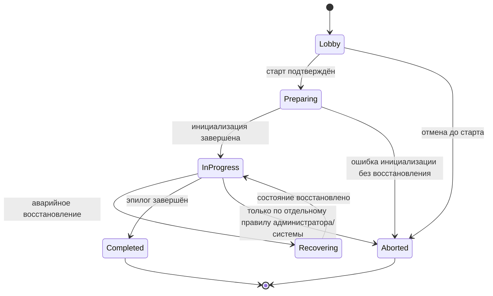
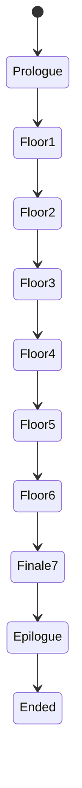
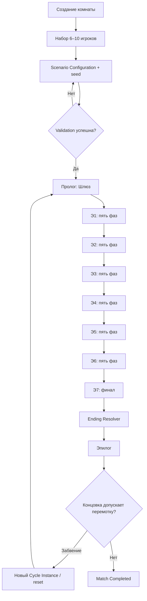

# МНЕМОСИН — MATCH_LIFECYCLE.md

**Целевая архитектура v4 · Draft 0.1**  
**Статус:** проектная спецификация для согласования и последующей реализации.  
**Дата:** 2026-11-09  
**Назначение:** описать полный жизненный цикл игровой партии: от создания комнаты и набора участников до старта, пролога, прохождения этажей, финала, концовки, сохранения результата и восстановления.

> Документ предназначен в том числе для автономного coding agent (Qwen 3.8 Max). Он отделяет подтверждённый игровой канон от архитектурных предложений и открытых правил. Примеры состояний, событий и контрактов ниже не являются автоматически утверждёнными названиями Zod-схем или API.

---

## 0. Статус, источники и правила использования

### 0.1. Источники

Документ основан на:

1. Пользовательском документе «ЦИКЛ 48 — игровой документ (сводка решений)», прежде всего §§1, 5–12, 14–15 и 18.
2. Первоначальном описании концепции игры в текущем разговоре: пролог в шлюзе, цикл этажей, особенности Э1–Э7, финал из четырёх взаимосвязанных условий и пять концовок.
3. `SYSTEM_ARCHITECTURE.md` — роли, верхнеуровневая архитектура, Observer, Scenario Configuration, восстановление и игровой цикл.
4. `HOT_COLD_DESIGN.md` — непрерывная HOT-симуляция, COLD-команды/события, межслойное взаимодействие и recovery.
5. `WORLD_SIMULATION.md` — иерархия World/Floor/WorldSpace, дискретный переход между этажами и загрузка World Pack.
6. `DOLL_AI.md` — захват, Детская/Стазис и ограничения поведения кукол.
7. `ANDREY_AI.md` — сюжетная арка Андрея и разделение канонического состояния/убеждений.
8. `NETWORK_PROTOCOL.md` — WebSocket lifecycle, проекции, reconnect/resync, Observer protocol.
9. Последующие решения пользователя:
   - игра работает в браузере;
   - партия не требует человеческого GM;
   - GM Review применяется только во время разработки и тестирования;
   - Observer («Бог») необязателен, не занимает слот игрока и видит всё скрытое игровое состояние;
   - права Observer на чтение и вмешательство разделены;
   - тактическая сложность кукол меняется от этажа к этажу;
   - LLM не управляет жизненным циклом партии и не определяет канонические исходы.

### 0.2. Статусы положений

- **СОГЛАСОВАНО** — явно установлено пользователем или исходным игровым документом.
- **ПРЕДЛАГАЕТСЯ** — архитектурное решение, рекомендуемое для реализации, но ещё требующее принятия.
- **ОТКРЫТО** — правило или параметр не определён; coding agent не должен изобретать его.
- **НЕ ВХОДИТ В ОБЪЁМ** — намеренно не описывается этим документом.

Статус относится к конкретному пункту, а не автоматически ко всему разделу.

### 0.3. Приоритет источников

При реализации соблюдать следующий порядок:

1. Последнее явное решение пользователя.
2. Положения со статусом **СОГЛАСОВАНО** в связанных архитектурных документах.
3. Положения со статусом **СОГЛАСОВАНО** в этом документе.
4. Исходный канон «Цикла 48» и первоначального описания концепции.
5. Положения со статусом **ПРЕДЛАГАЕТСЯ** — только как варианты реализации.
6. Существующий код — достоверный источник сведений о текущей реализации, но не автоматическое основание сохранять устаревшие Turn Engine/GM workflow в целевой v4.

Если два источника противоречат друг другу и приоритет не позволяет однозначно разрешить конфликт, coding agent должен остановиться на этом участке, описать конфликт и не выбирать правило самостоятельно.

### 0.4. Инструкции автономному coding agent

Перед реализацией:

1. Прочитать все связанные документы целевой архитектуры и исходный «Цикл 48».
2. Проверить фактическое состояние репозитория: модули Session, StateService, Journal, Story, Chat, Inventory/Items, EventBus/Outbox, database adapters, WS gateways, контракты и тесты.
3. Составить карту существующих реализаций и повторно используемых компонентов. Не переписывать работающие части только ради соответствия предлагаемым каталогам.
4. Не переносить бизнес-логику партии в HOT tick и не возвращать Turn Engine.
5. Не добавлять человеческий GM как обязательного участника партии.
6. Не трактовать Observer как игрока и не включать его в лимит 6–10 участников.
7. Не придумывать состав ролей для партий на 7, 9 или 10 участников, правила голосования, AFK/disconnect, точные таймеры и точные условия спасения захваченных.
8. Не выводить скрытые роли или факты в PlayerProjection.
9. Не позволять клиенту, LLM или Observer обходить доменные правила и напрямую менять канонический GameState.
10. Все состояния, команды и события реализовывать с Zod-валидацией, идемпотентностью, журналированием и тестами.
11. В отчёте перечислять изменённые файлы, фактически реализованные переходы, тесты, допущения и оставшиеся открытые вопросы.
12. Не изменять код за пределами запрошенного этапа и не реализовывать открытые сюжетные решения без отдельного согласования.

---

# 1. Назначение и границы документа

## 1.1. Назначение

`MATCH_LIFECYCLE.md` описывает оркестрацию партии как целого. Он отвечает на вопросы:

- когда матч создаётся и когда допускается старт;
- какие сущности входят в матч;
- как задаются роли и seed партии;
- как матч проходит пролог, этажи Э1–Э6, финал Э7 и эпилог;
- как пять фаз каждого этажа соотносятся с непрерывной симуляцией;
- что происходит с игроками, оставшимися наверху или захваченными;
- когда матч считается завершённым;
- как вычисляется концовка и что означает перемотка;
- что сохраняется и как матч восстанавливается после отказа.

## 1.2. Что документ не определяет

Не дублировать здесь детальные правила, принадлежащие другим спецификациям:

| Область                                                          | Основной документ                          |
| ---------------------------------------------------------------- | ------------------------------------------ |
| HOT 20 Гц, COLD, event commit, snapshots                         | `HOT_COLD_DESIGN.md`                       |
| Геометрия, World Pack, движение, газ, свет, акустика             | `WORLD_SIMULATION.md`                      |
| Тактическое поведение кукол и захват                             | `DOLL_AI.md`                               |
| Память, убеждения, диалоги и LLM Андрея                          | `ANDREY_AI.md`                             |
| Внешний WebSocket-протокол, reconnect и проекции                 | `NETWORK_PROTOCOL.md`                      |
| Общие модули и архитектурные границы                             | `SYSTEM_ARCHITECTURE.md`                   |
| Точные рецепты и правила предметов, если будут вынесены отдельно | будущая спецификация игровых систем/крафта |

Этот документ определяет, **когда** соответствующие системы активируются и какие lifecycle-события они получают. Он не переопределяет их внутренние алгоритмы.

## 1.3. Ключевой принцип

**Матч — непрерывная игровая сессия с дискретными сценарными переходами.**

Партия не является последовательностью ходов. Пять фаз этажа, переходы между этажами, захваты, голосования и финал — состояния и события COLD. HOT продолжает симуляцию в пределах правил текущего состояния, пока сервер явно не деактивирует конкретный World Runtime или весь матч по согласованному lifecycle-переходу.

---

# 2. Подтверждённые параметры игры

## 2.1. Формат

**СОГЛАСОВАНО:**

- Жанр: социальная дедукция + выживание + крафт.
- Количество игроков: 6–10.
- Ориентировочная длительность: 4–5 часов.
- Формат: браузерная SPA с наклонной 2D-сценой и DOM-интерфейсами.
- Партия должна запускаться и завершаться без обязательного человеческого ведущего.
- Observer — дополнительная роль, не занимающая слот игрового участника.
- Прямые убийства с выбыванием игроков отсутствуют.
- Захваченные игроки остаются частью партии.
- Игровая истина, роли, результаты крафта и концовки определяются сервером.

## 2.2. Макроструктура партии

**СОГЛАСОВАНО по исходной концепции:**

1. Пролог — Шлюз.
2. Этажи Э1–Э6 — каждый проходит через пять фаз.
3. Финал — Э7.
4. Эпилог — одна из предусмотренных концовок и, в отдельных исходах, перемотка.

Э7 не является обычным этажом цикла исследования: там нет крафта и новых улик; группа использует то, что принесла с собой.

## 2.3. Ориентировочные длительности

В первоначальном описании указаны:

| Часть         | Ориентировочная длительность | Статус                              |
| ------------- | ---------------------------: | ----------------------------------- |
| Пролог / Шлюз |               около 25 минут | **ПРЕДЛАГАЕТСЯ как ориентир**       |
| Финал / Э7    |               около 40 минут | **ПРЕДЛАГАЕТСЯ как ориентир**       |
| Эпилог        |               около 15 минут | **ПРЕДЛАГАЕТСЯ как ориентир**       |
| Полная партия |              около 4–5 часов | **СОГЛАСОВАНО как целевой масштаб** |

Длительности не должны автоматически превращаться в жёсткие таймеры. Время пяти фаз этажей и правила автоматического перехода по таймауту не определены.

---

# 3. Сущности жизненного цикла

## 3.1. Match

`Match` — одна полная игровая партия, имеющая собственный идентификатор, сценарную конфигурацию, seed, участников, историю, текущий этаж и итог.

Предлагаемые поля concept-level:

```ts
interface Match {
  matchId: string;
  lifecycleStatus: MatchLifecycleStatus;
  progressionStage: MatchProgressionStage;
  currentFloorId: string | null;
  currentFloorPhase: FloorPhase | null;
  scenarioSeed: string;
  scenarioConfigVersion: number;
  createdAt: string;
  startedAt: string | null;
  completedAt: string | null;
  revision: number;
}
```

Это не финальная схема хранения. Поля и типы должны быть согласованы с текущими Entity/StateService/Drizzle conventions.

## 3.2. Participant

`Participant` — пользователь/актор, связанный с матчем. Игровой участник занимает слот одного из 6–10 игроков. Observer не занимает игровой слот.

Не смешивать:

- аккаунт/пользовательскую идентичность;
- membership в матче;
- игровую роль;
- состояние персонажа;
- состояние сетевого соединения.

## 3.3. Player Character

Игровой персонаж имеет роль, пространственное положение, состояние участия и набор игровых состояний (например, заражение, экипировка, захват).

Роль и скрытые поля не отправляются игроку без предусмотренного сценарного раскрытия. Сервер формирует PlayerProjection отдельно для каждого участника.

## 3.4. Floor Instance

`Floor Instance` — конкретное runtime-прохождение этажа в конкретном матче. Оно связано с World Pack, активным WorldSpace, фазой этажа, динамическими объектами, ресурсами, инцидентами и участниками, находящимися на этаже.

**ПРЕДЛАГАЕТСЯ:** отделить постоянный `FloorDefinition`/World Pack от изменяемого `FloorInstanceState`. Повторное прохождение того же этажа в другом матче создаёт отдельный instance state.

## 3.5. Floor Phase

`FloorPhase` — высокоуровневый сценарный режим текущего этажа. Он меняет доступные цели и правила, но не является turn boundary и сам по себе не останавливает HOT.

## 3.6. Participant gameplay state и connection state

Эти состояния независимы.

Примеры gameplay state, известные из канона:

- обычное участие на текущем этаже;
- оставлен наверху как опора;
- захвачен / находится в Детской или Стазисе;
- находится в финале (если допущен к Э7).

Connection state определяется сетевым протоколом: connected, disconnected, reconnecting и другие технические состояния.

Отключение от сети не должно автоматически считаться игровым захватом, смертью или выходом из партии.

---

# 4. Два независимых автомата состояния

## 4.1. Почему нельзя смешивать состояния

У матча есть как минимум два разных измерения:

1. **Lifecycle status** — существует ли матч, собирает ли участников, идёт ли игра, восстанавливается ли она, завершена ли.
2. **Progression stage** — на каком сюжетно-игровом участке находится партия.

Дополнительно внутри `ActiveFloor` существует `FloorPhase`.

Такое разделение не позволяет создавать комбинаторный enum вроде `FLOOR_3_INCIDENT_RUNNING`.

## 4.2. Предлагаемый MatchLifecycleStatus

Иллюстративный набор:

```ts
type MatchLifecycleStatus =
  'lobby' | 'preparing' | 'in_progress' | 'recovering' | 'completed' | 'aborted';
```

**ПРЕДЛАГАЕТСЯ:** использовать этот набор как стартовую модель. `recovering` может быть техническим статусом процесса, а не обязательно пользовательским состоянием БД. Проверить необходимость сохранения его в долговременном Match record.

## 4.3. Предлагаемый MatchProgressionStage

```ts
type MatchProgressionStage = 'prologue' | 'floor' | 'finale' | 'epilogue' | 'ended';
```

`currentFloorId` различает Э1–Э7, а `FloorPhase` применяется только к Э1–Э6.

## 4.4. FloorPhase

**СОГЛАСОВАНО:** пять фаз цикла каждого этажа Э1–Э6:

```ts
type FloorPhase = 'entry_air' | 'exploration' | 'incident' | 'debrief' | 'threshold';
```

Эти идентификаторы — предлагаемые технические значения для Zod/TypeScript. Их точные имена могут быть приведены к convention репозитория, смысл пяти фаз сохраняется.

## 4.5. Упрощённая схема переходов



Это жизненный цикл всей сессии. Внутренний progression описывается отдельной схемой.

## 4.6. Переходы progression



Схема показывает основную последовательность. Она не определяет автоматически, что происходит при провале порога, недостатке активных участников или исходе «Забвение».

## 4.7. Переходы не должны происходить скрыто

Каждый progression transition — отдельная COLD-команда/use case с проверкой предусловий, идемпотентным ID и записью истории. HOT runtime меняет активный WorldSpace только после подтверждённого сценарного перехода.

---

# 5. Создание комнаты и набор участников

## 5.1. Базовая модель

**СОГЛАСОВАНО:** для партии нужны 6–10 игровых участников. Observer не занимает слот игрока и не является условием запуска.

**ОТКРЫТО:** исходные документы не задают полный UX создания комнаты: кто её создаёт, является ли создатель host, как устроены приглашения, публичный поиск, пароль/код комнаты и правила выхода из lobby.

## 5.2. Предлагаемые состояния комнаты

До начала матча room/session может использовать состояние lobby. Предлагаемые переходы:

- создание комнаты → `lobby`;
- присоединение/выход участника → обновление состава lobby;
- достижение допустимого состава → возможность начать проверку готовности;
- старт → `preparing`;
- успешная подготовка → `in_progress`.

Это техническая рекомендация, не каноническая игровая механика. Не добавлять автоматический matchmaking или публичный браузер комнат без отдельного требования.

## 5.3. Preconditions старта

**СОГЛАСОВАНО:** количество игровых участников — от 6 до 10.

**ПРЕДЛАГАЕТСЯ:** сервер разрешает старт, если:

- в комнате находится допустимое число уникальных игровых участников;
- каждый участник имеет валидную session/membership;
- выбран/зафиксирован совместимый World Pack и версия сценарных данных;
- можно сформировать валидную Scenario Configuration;
- конфигурация проходит validation;
- отсутствует другая уже запущенная партия в этой же комнате.

Готовность каждого участника и обязательность ready-check — **ОТКРЫТО**.

## 5.4. Observer во время подготовки

Observer может быть присоединён к матчу как отдельный actor type. Его присутствие не влияет на минимальное/максимальное число игроков и не блокирует старт.

**ОТКРЫТО:** допускается ли присоединение Observer до старта, во время партии или в обоих случаях. Архитектура должна поддерживать Observer отдельно от player slots.

## 5.5. Выход из lobby

Удаление участника из lobby не должно создавать игровое событие матча, потому что партия ещё не началась. После перехода в `in_progress` правила выхода определяются lifecycle/disconnect policy, а не lobby membership.

---

# 6. Подготовка матча и Scenario Configuration

## 6.1. Ответственность подготовки

После команды старта сервер переводит матч в `preparing` и готовит единую каноническую конфигурацию. Она должна быть полностью сформирована и проверена до показа игрокам персональной игровой информации.

## 6.2. Состав Scenario Configuration

**СОГЛАСОВАНО на концептуальном уровне:** конфигурация выбирается алгоритмически по seed, без LLM.

Она может содержать:

- распределение ролей;
- идентификатор Коли;
- назначение роли Слышащего;
- пару подменённых персонажей/якорей;
- состояния заражения;
- испорченные/подменённые предметы;
- конфигурации кукол;
- допустимые варианты инцидентов;
- сценарные модификаторы и вариации после перемотки.

Не все поля должны обязательно меняться в каждой партии.

## 6.3. Ролевой состав

В исходном базовом примере на шесть участников:

- 1 Коля — мирный, центр финала, носит Неофрона;
- 3 Дети;
- 2 Приёмных ребёнка Неофрона — сознательные заражённые.

Количество игроков по ролям меняется при общем составе 6–10.

**ОТКРЫТО:** точная функция распределения ролей для 7, 8, 9 и 10 участников. Coding agent не должен линейно экстраполировать состав по собственному усмотрению.

## 6.4. Скрытые назначения

Распределение ролей, заражение, подменённые якоря и качество предметов являются серверными данными. Игрок получает только свою PlayerProjection и те сведения, которые открываются игровыми событиями.

В исходной концепции заражённые постепенно узнают друг друга; на Э6 появляется «чувство семьи», позволяющее им видеть друг друга на карте. Точный момент и способ узнавания до Э6 не определены в lifecycle и должны оставаться в правилах роли/информации.

## 6.5. Seed и воспроизводимость

Seed должен позволять воспроизвести алгоритмически выбранную конфигурацию и тактические варианты, если все входные версии данных сохранены.

**ПРЕДЛАГАЕТСЯ:** хранить вместе с seed:

- версию алгоритма генерации;
- версию role table;
- версию World Pack;
- версии floor profiles;
- версию сценарных данных;
- итоговую нормализованную конфигурацию или её проверяемый snapshot.

Seed сам по себе не заменяет хранение канонической конфигурации партии: при изменении алгоритма старую партию необходимо восстанавливать по сохранённой версии/конфигурации, а не случайно генерировать заново.

## 6.6. Проверка конфигурации

Перед `preparing → in_progress` проверять:

- число и уникальность участников;
- ровно одного Коли, если правило сохраняется для данной конфигурации;
- допустимое количество ролей по утверждённой таблице;
- существование обязательных персонажей и стартовых предметов;
- валидность подмены якорей;
- целостность ссылок на World Pack и floor profiles;
- допустимость состояний предметов;
- выполнимость технических предусловий, которые уже формализованы.

Проверка не должна пытаться решить неописанные вопросы сюжетной проходимости. Список формальных balance invariants должен быть отдельным.

## 6.7. Фиксация результата подготовки

После успешной валидации сервер сохраняет:

- match record и участников;
- scenario seed/version/config;
- исходные игровые роли и скрытые состояния;
- стартовые предметы/якоря;
- первоначальную позицию/стартовый WorldSpace;
- событие `match.prepared` (название иллюстративно).

Только после commit сервер рассылает участникам стартовую проекцию и переводит progression в Prologue.

---

# 7. Пролог — Шлюз

## 7.1. Назначение

Пролог — начальное игровое пространство до основного спуска. По исходному описанию его ориентировочная длительность составляет около 25 минут.

## 7.2. Канонические события пролога

**СОГЛАСОВАНО по концепции:**

- участники приходят в себя в холодном шлюзе без памяти;
- дверь заперта;
- газ ещё не полностью выветрился;
- игроки находят маски и первые фильтры;
- игроки находят личные якоря — предметы, связанные с личностью;
- возникают первые подозрения, связанные с якорями и поведением;
- открытие гермодвери на Э1 требует совместного действия двух-трёх участников;
- на этом этапе роли заражённых ещё не раскрыты;
- заражённые могут ощущать смутный импульс против спуска, но не получают полного раскрытия роли до Э2–Э3 согласно первоначальному описанию.

В `Цикле 48` указано, что шестеро просыпаются в шлюзе; при этом общий размер партии составляет 6–10. Как масштабировать стартовую сцену/описание для 7–10 игроков — **ОТКРЫТО**.

## 7.3. Интерактивный режим

Пролог использует ту же непрерывную сцену и HOT/COLD, что и остальные этажи. Не создавать отдельную мини-игру или turn-based режим.

Совместное открытие гермодвери — дискретное COLD-взаимодействие с пространственными предусловиями, проверяемыми сервером.

## 7.4. Завершение пролога

**ПРЕДЛАГАЕТСЯ:** пролог завершается после выполнения серверных условий стартовой сцены и открытия перехода на Э1. Не привязывать переход к одному лишь истечению 25 минут.

**ОТКРЫТО:** полный перечень обязательных действий пролога, возможность пропустить часть обучения и правила поведения игрока, который не взаимодействует с предметами.

## 7.5. Скрытые знания в прологе

Пролог не должен показывать заражённым полную карточку роли или заражения, если это противоречит канону отложенного раскрытия. Точный формат «смутного импульса» является игровым дизайном и не должен добавляться coding agent самостоятельно.

---

# 8. Цикл этажа Э1–Э6

## 8.1. Общая последовательность

На каждом этаже Э1–Э6 действует пять фаз:

1. Вход и оценка воздуха (`entry_air`).
2. Исследование (`exploration`).
3. Инцидент (`incident`).
4. Разбор (`debrief`).
5. Порог (`threshold`).

Фазы не меняют режим игры. Игроки продолжают находиться в одной реальной пространственной сцене.

## 8.2. Phase state — не turn engine

Фаза — это COLD-состояние сценария/этажа. Она может:

- менять доступные objectives;
- разрешать/ограничивать отдельные действия;
- открывать/закрывать фазовые решения;
- активировать заранее предусмотренные триггеры;
- формировать сводки и условия перехода.

Фаза не должна:

- сериализовать действия игроков в ходы;
- останавливать HOT на время обсуждения;
- ждать LLM;
- требовать GM approval;
- создавать отдельный игровой режим/экран мини-игры без отдельного решения.

## 8.3. Фаза 1 — Вход и оценка воздуха

Игровой смысл:

- группа стоит у шлюза следующего этажа;
- оценивается концентрация газа;
- при наличии сканера изучаются показания;
- распределяются фильтры;
- решается, кто несёт сканер;
- выбирается, спускаться сейчас, остаться или подготовиться.

Важные социальные последствия:

- показания сканера можно интерпретировать неверно или сообщать о них ложно;
- распределение фильтров и решения о риске становятся частью будущей дедукции;
- состояние ресурсов и передачи предметов должно быть объективно записано сервером, но публичность отдельных записей зависит от правил соответствующих предметов.

**ОТКРЫТО:** формальные условия завершения фазы, обязательность сканера, точный голосовательный threshold и автоматическое поведение при отсутствии согласия.

## 8.4. Фаза 2 — Исследование

Игровой смысл:

- свободное перемещение по сцене;
- поиск записок, аудио, компонентов и фрагментов чертежей;
- исследование комнат и объектов;
- взаимодействие с терминалами;
- общение: общий чат, шёпот вблизи, приватное взаимодействие при сближении согласно правилам Social/Network;
- оставление и подбор физических записок;
- обращение к Андрею через разрешённые динамики/комнату;
- работа с доступными на этаже станциями.

Каноническое уточнение: в «Цикле 48» сказано «мир не мутируется — игроки только запрашивают информацию». В контексте остальных правил это не следует трактовать как запрет на открытие дверей, переключение света, подбор предметов или саботаж. **ПРЕДЛАГАЕМАЯ интерпретация:** в фазе исследования нет произвольной генерации/перестройки сюжета; авторитетные изменения мира происходят только через предусмотренные игровыми правилами взаимодействия.

Заражённые могут выполнить предусмотренный саботаж исследования: испортить документ, спрятать компонент, подложить фальшивку или солгать Коле. В исходном документе указано «раз на этаж»; точный владелец/распределение лимита между заражёнными — **ОТКРЫТО**.

## 8.5. Фаза 3 — Инцидент

Игровой смысл:

- этаж реагирует на триггеры;
- могут активироваться куклы;
- игроки решают локальные проблемы выживания;
- могут требоваться совместные действия (например, удерживать дверь и вводить код);
- заражённые получают/выполняют приватную цель инцидента согласно сценарию;
- захват переводит игрока в состояние Captured/Стазис, но не удаляет его из партии.

Инцидент не обязан означать появление нового объекта или нового правила. Он может проверять использование уже известных ресурсов, маршрутов, света, дверей и укрытий.

**ОТКРЫТО:** каталог инцидентов каждого этажа, способ выбора, обязательность одного инцидента на этаж, возможность нескольких/прерванных инцидентов и точные тайминги.

## 8.6. Фаза 4 — Разбор

Игровой смысл:

- участники сходятся в согласованной точке/зоне;
- сопоставляют, кто где был, что нашёл и сколько фильтров осталось;
- получают сводку контактов;
- предъявляют диктофонные записи, документы и иные результаты;
- используют Проявитель/Детектор, если они доступны и собраны;
- обвиняют, защищаются и договариваются.

Сводка контактов не должна превращаться в автоматическое раскрытие содержания приватных сообщений. Она относится к следам/контактам и подчиняется Social/Privacy правилам.

**ОТКРЫТО:** обязательно ли всем собираться в одной точке, точная форма сводки контактов и автоматическое завершение разбора.

## 8.7. Фаза 5 — Порог

Игровой смысл:

- группа принимает решение у гермодвери;
- решает, спускаться ли ниже;
- может обсуждаться изоляция подозреваемого в рамках предусмотренных правил;
- выбирает, кого оставить наверху как опору;
- оставшийся игрок не выбывает: становится отдельным участником верхнего уровня поддержки с возможностью влиять на ход партии.

В исходном «Цикле 48» используется формулировка «консенсус большинства» и «необратимо вниз».

**СОГЛАСОВАНО:** оставленный наверху не выпадает из матча. Возможные функции: крафт фильтров, связь, охрана, присмотр за усыплёнными детьми или комнатой Андрея, передача ресурсов/записок вниз. Оставшийся может предать или скрыть информацию.

**ОТКРЫТО:** точный порог голосования, может ли быть оставлено несколько игроков, можно ли позже присоединиться к группе, конкретные действия верхнего уровня и точная семантика «необратимо вниз» для персонажа, оставшегося наверху.

## 8.8. Переход phase-to-phase

**ПРЕДЛАГАЕТСЯ:** переход фазы выполняет `FloorProgressionService` как COLD use case после проверки предусловий. Он фиксирует:

- прежнюю фазу;
- новую фазу;
- причину/условие перехода;
- актор (system, игроки через голосование, сценарный триггер);
- event/command ID;
- revision матча и этажа.

HOT получает только те runtime-изменения, которые действительно нужны для пространственной симуляции. Сам факт смены фазы не должен автоматически сбрасывать позиции игроков, кукол или объекты.

## 8.9. Таймеры фаз

Длительность полного матча ориентировочно 4–5 часов, но точные длительности пяти фаз по этажам не определены.

Не вводить автоматический принудительный переход по таймеру без отдельного решения. Если в будущем появятся таймеры:

- использовать игровое/логическое время матча;
- сохранять deadline и pause policy;
- определять поведение при reconnect/recovery;
- явно указывать, какие фазы могут завершиться таймаутом.

---

# 9. Особенности этажей

## 9.1. Таблица известного содержания

Таблица фиксирует только сведения, имеющиеся в концепции и «Цикле 48». Она не является полной картой или полным каталогом событий.

| Участок       | Подтверждённое содержание и роль в прогрессии                                                                                                                  | Не определено                                                                                                          |
| ------------- | -------------------------------------------------------------------------------------------------------------------------------------------------------------- | ---------------------------------------------------------------------------------------------------------------------- |
| Шлюз / Пролог | Пробуждение, маски, первые фильтры, якоря, запертая дверь, совместное открытие прохода                                                                         | Масштабирование стартовой сцены на 7–10 игроков, точная последовательность интеракций                                  |
| Э1            | Туториал; низкое заражение; одна кукла; обучение базовым взаимодействиям                                                                                       | Полный перечень обучения, критерии окончания туториала                                                                 |
| Э2            | Обнаружение усыплённых настоящих детей; морг/мортурий, био-образцы, прототип антидота                                                                          | Точное число/местоположение детей и условия доступа                                                                    |
| Э3            | Перелом; раскрытие ролей заражённых; операционная; сборка антидота; чертёж Детектора; пробуждение ребёнка                                                      | Точные условия пробуждения, детальная выдача личных воспоминаний мирным                                                |
| Э4            | Химлаб; сборка Проявителя; подпись Андрея на разрешении №12; рядом комната Андрея                                                                              | Точный триггер признания и условия доступа к комнате                                                                   |
| Э5            | Радиорубка; сборка Детектора; финальная партия антидотов; доступна одна специальная атака/«убийство» заражённых по правилам §6                                 | Лимиты и условия специальной атаки, детальный состав инцидентов                                                        |
| Э6            | Неофрон активен; уровень перестраивается; список 47 групп; раскрытие правды о подмене; чувство семьи у заражённых и дополнительный саботаж                     | Конкретная перестройка World Pack, точный смысл списка/отсутствующего участника и новые тактические capabilities кукол |
| Э7            | Финальный терминал и Коля; крафта и новых улик нет; четыре нити финала; возможна подмена шприца Неофроном; исход Доминации связан с захватом терминала куклами | Полная последовательность финальной сцены, тайминги и точные условия блокировки действий                               |

## 9.2. Станции крафта — только lifecycle-вехи

Согласно «Циклу 48»:

- Э2 — мортурий: био-образцы, прототип антидота, усыплённые дети;
- Э3 — операционная: сборка антидота, чертёж Детектора, пробуждение ребёнка;
- Э4 — химлаб: сборка Проявителя, подпись Андрея, комната Андрея рядом;
- Э5 — радиорубка: сборка Детектора, финальная партия антидотов;
- Э6–Э7 — крафта нет, только доставка/защита и финальные решения.

В «Цикле 48» также явно описана намеренная ловушка: антидот доступен раньше Проявителя. Сборка до проверки компонентов несёт риск. Не переставлять порядок станций и не «исправлять» эту ловушку в реализации.

Рецепты, точные компоненты, качество результата и индивидуальные права крафта принадлежат будущей спецификации Crafting/Items.

## 9.3. Контент и новые улики

На Э7 новых улик нет. Игроки используют только то, что принесли с собой и что уже было зафиксировано/получено ранее.

Нельзя создавать скрытые «спасающие» улики или выдавать новые доказательства игрокам в финале через LLM.

---

# 10. Участники, оставленные наверху и захваченные игроки

## 10.1. Базовый инвариант

**СОГЛАСОВАНО:** игрок не должен выбывать из партии из-за игрового захвата. «Убийство» не означает удаление игрока.

В матче могут существовать участники в разных игровых контекстах:

- активная группа на текущем этаже;
- игроки, оставленные наверху как опора;
- игроки в Детской/Стазисе после захвата.

Точные названия participant states должны быть единообразны с `DOLL_AI.md` и `HOT_COLD_DESIGN.md`.

## 10.2. Оставленный наверху

Игрок, которого группа решила оставить на пороге, остаётся участником того же матча.

Возможные функции, подтверждённые концепцией:

- изготовление/поддержка фильтров;
- поддержание связи;
- охрана;
- присмотр за усыплёнными детьми;
- защита/поддержка комнаты Андрея;
- передача записок и ресурсов вниз.

Этот игрок получает самостоятельный рычаг влияния и может скрывать информацию/предать группу.

**ОТКРЫТО:**

- какие конкретные команды доступны оставленному;
- требует ли каждая команда времени/ресурса;
- может ли верхний уровень подвергаться отдельным инцидентам;
- может ли оставленный позже спуститься/быть спасён;
- как физически и сетево синхронизируются разные Floor Instance/WorldSpace.

## 10.3. Захваченный игрок

**СОГЛАСОВАНО:** куклы не убивают; захваченный игрок отправляется в Детскую/Стазис и остаётся в партии.

Исходная концепция сообщает, что захваченный может наблюдать, отправить одну подсказку и быть спасён. «Цикл 48» добавляет, что заражённый, попавший в Детскую, может продолжить саботаж через канал шёпота кукол. Совместить эти положения можно только через отдельные разрешённые actions, но точные правила ещё не заданы.

**ОТКРЫТО:**

- точный набор действий в Детской;
- видит ли захваченный всю карту, отдельную область или только определённую проекцию;
- точный лимит подсказок;
- какие условия и команды позволяют спасти игрока;
- может ли спасение происходить на любом этаже или только на определённых;
- как захваченный заражённый выполняет саботаж и какие у него ограничения.

## 10.4. Захват — не финальное удаление участника

COLD не должен переводить захваченного в `eliminated`/`dead`, если такие статусы вообще существуют для технических причин. Захват — отдельное игровое состояние с собственными правилами.

При переносе в Детскую HOT и Doll AI отвечают за пространственное движение, COLD — за подтверждённый статус и журнал. События захвата/доставки идемпотентны.

## 10.5. Disconnect не равен захвату

Сетевая потеря клиента не должна сама создавать захват или менять роль. Политика персонажа при длительном отсутствии связи остаётся открытой и должна быть определена отдельным решением.

---

# 11. Саботаж и специальная атака заражённых в жизненном цикле

## 11.1. Общие возможности

«Цикл 48» описывает сознательных заражённых, которые имеют преимущество в информации и инициативе, но не сверхспособности.

Известные действия:

- приватный канал, оставляющий след;
- тайная цель в инциденте;
- саботаж в фазе исследования: испортить документ, спрятать компонент, подложить фальшивку или соврать Коле;
- ложные сообщения о найденном;
- обвинение невиновных и саботаж крафта;
- атака на канал/оборудование Андрея (изоляция/отключение питания прибора, не убийство Андрея);
- на Э6 «чувство семьи» и дополнительный саботаж;
- если заражённый захвачен, канал саботажа меняется на шёпот кукол.

## 11.2. Лимиты

В исходном документе указано «раз на этаж» для саботажа в исследовании и «одно убийство за игру, только на этаже 5 или 6».

**ОТКРЫТО:** являются ли лимиты общими на команду заражённых или индивидуальными на каждого заражённого; когда именно они расходуются; можно ли отменить неудачную попытку; сбрасывается ли лимит после перемотки.

Coding agent обязан реализовать лимиты только после получения однозначного доменного правила.

## 11.3. «Одно убийство» — не смерть

Допустимые в исходном описании формы:

- оставить без фильтра;
- запереть с куклой;
- столкнуть в шахту.

Результат — `Captured`/`Stasis`, а не удаление участника из партии.

**ОТКРЫТО:** конкретный способ выбора цели, доступные контрмеры, проверки ресурсов, момент расходования лимита и является ли это одной командной возможностью или персональной.

---

# 12. Переход между этажами

## 12.1. Переход — COLD-действие

Переход между этажами — дискретное действие, а не физическое перемещение через границу карты.

`WORLD_SIMULATION.md` задаёт общую последовательность:

1. COLD проверяет правила порога, голосование/консенсус, состав участников и доступность перехода.
2. COLD фиксирует новый `FloorId`/`WorldSpaceId` и progression stage.
3. Текущий World Runtime деактивируется/сохраняется согласно lifecycle policy.
4. Загружается World Pack следующего этажа и его начальные динамические состояния.
5. Участники размещаются в заданных spawn points.
6. Клиенты получают новую scene keyframe/projection.

## 12.2. Игроки не переходят как один обязательный блок

На пороге часть группы может быть оставлена наверху. Поэтому переход должен поддерживать несколько групп участников и их раздельные игровые контексты.

**ПРЕДЛАГАЕТСЯ:** матч хранит `participantLocationContext` отдельно для каждого участника. Оно не должно предполагать, что все участники всегда находятся в одном `FloorId`.

## 12.3. Необратимость порога

В «Цикле 48» порог описан как необратимое движение вниз. Это означает, что нельзя просто открыть карту предыдущего этажа и свободно вернуться туда обычным движением.

Но игрок, оставшийся наверху, продолжает существовать в предыдущем пространстве и участвовать через разрешённые механики поддержки.

**ОТКРЫТО:** возможны ли особые сценарные возвраты/спасательные экспедиции и как они влияют на необратимость. Не реализовывать произвольный backtracking.

## 12.4. Неуспешный порог

Если группа не может принять решение, правила fallback не заданы.

Нельзя самостоятельно вводить автоматический спуск, автоматическое оставление случайного игрока или таймаутное голосование. Это отдельное открытое правило.

---

# 13. Финал — Э7

## 13.1. Переход в финальную сцену

После Э6 партия переходит к Э7 через COLD progression transition и загрузку финального World Pack/сцены.

**СОГЛАСОВАНО:**

- крафта на Э7 нет;
- новых улик нет;
- группа использует принесённые знания, устройства, предметы и доказательства;
- Коля находится в центре финального решения;
- ориентировочная длительность финала — около 40 минут, не фиксированный timer.

## 13.2. Четыре нити финала

Финал не должен быть реализован как один бинарный выбор шприца. Он зависит от схождения четырёх независимых линий:

1. **Шприц / антидот.** Коле вводят чистый или испорченный антидот. Чистый ведёт к Интеграции; испорченный — к Кристаллизации.
2. **Имя.** Слышащий может произнести «Алиса» у Терминала. Это альтернативный путь растворения Неофрона.
3. **Подмена.** Когда Неофрон находится в состоянии `ЯВЕН` (название из исходной концепции), он может физически подменить шприц в финальной сцене.
4. **Проявитель.** Если он собран из заражённых компонентов, он мог лгать на протяжении всей партии; предыдущие проверки не гарантировали подлинность.

Четыре линии сохраняются как самостоятельные факты/состояния, даже если в конкретной партии часть из них отсутствует или не выполнена.

## 13.3. Роль игроков в финале

Заражённые пытаются ускорить введение испорченного антидота, убедить группу и получить доступ к шприцу.

Мирные пытаются проверить качество предмета, защитить Колю, удержать Слышащего и решить, кому доверить инъекцию.

Это описание драматургии. Точные взаимодействия, физические блокировки, тайминги, проверки ролей и правила одновременных команд требуют отдельной спецификации финальной сцены.

## 13.4. Финальное состояние предметов

Нельзя выводить фактическое качество шприца из того, как его описывает игрок или LLM. Каноническое качество хранится на сервере и отдельно от сообщённого/предполагаемого качества.

Фактическая подмена Неофроном также фиксируется отдельным серверным событием и должна быть доступна Observer, но не обязательно игрокам.

## 13.5. Разрешение финала

**ПРЕДЛАГАЕТСЯ:** `FinaleResolutionService` вычисляет результат на основе заранее сохранённых канонических фактов и итоговых действий игроков, после чего атомарно фиксирует `endingId` и `completedAt`/переход в Epilogue.

Разрешение должно быть идемпотентным. Повторное получение одного и того же финального события не должно создать разные концовки.

**ОТКРЫТО:** точный порядок обработки почти одновременных действий (инъекция, произнесение имени, подмена, блокировка терминала) и приоритет исходов, если условия нескольких концовок совпадают.

---

# 14. Концовки и перемотка

## 14.1. Перечень концовок

Исходная концепция определяет пять концовок:

1. Идеальная.
2. Хорошая.
3. Кристаллизация.
4. Забвение.
5. Доминация.

Точные условия должны храниться в одном каноническом Ending Ruleset, а не разбрасываться по UI, HOT, Doll AI и LLM.

## 14.2. Идеальная концовка

Указанные условия:

- оба стартовых заражённых исцелены;
- ни один мирный не заражён (или заражённый мирный впоследствии исцелён);
- двое усыплённых настоящих детей разбужены и выведены;
- Коле введён чистый антидот → Интеграция;
- никто не остался в Детской;
- произнесение имени Слышащим у Терминала — альтернативное/дополнительное условие, точная обязательность которого помечена в исходном тексте как «альт/доп».

**ОТКРЫТО:** точная трактовка «оба стартовых заражённых исцелены» при динамическом появлении новых заражённых после испорченного антидота; обязательность имени для Ideal.

## 14.3. Хорошая концовка

Условие: Коле введён чистый антидот → Интеграция, но хотя бы один из дополнительных пунктов Идеальной концовки не выполнен.

**ОТКРЫТО:** как классифицировать случай, когда инъекция чистая, но одновременно выполнены условия, которые могут запустить другую концовку (например, Доминацию терминала). Не кодировать приоритет без таблицы приоритетов.

## 14.4. Кристаллизация

Канонический триггер: Коле введён испорченный антидот.

Последствия:

- Неофрон кристаллизуется в теле Коли;
- точка входа стирается;
- перемотка невозможна навсегда;
- Петля умирает, но Неофрон остаётся в человеке, который больше не Коля;
- дополнительное объяснение: кристаллизация вытягивает Мнемосин из комплекса, прибору не на что опираться.

После подтверждённой Кристаллизации матч не должен запускать reset-to-gate.

## 14.5. Забвение

Каноническое описание для базового состава:

- Коля — единственный чистый;
- все пятеро остальных детей заражены;
- Андрей нажимает рычаг;
- группа возвращается в Шлюз;
- игроки помнят прошлый цикл (дежавю), персонажи — нет;
- новая конфигурация получает новых заражённых.

**ОТКРЫТО:** адаптация условия «все пятеро остальных детей» к партиям более чем на шесть участников и к динамическому заражению; точное условие, при котором Андрей может/решает нажать рычаг; ротация пары заражённых после перемотки.

### 14.5.1. Модель перемотки

**ПРЕДЛАГАЕТСЯ:** не перезаписывать завершённый цикл задним числом. Создавать новый `CycleInstance`/новую progression iteration внутри той же связанной метаистории или новый Match, связанный `parentMatchId`/`previousCycleId`.

Причина: необходимо сохранить историю завершившегося цикла, дать игрокам мета-память и при этом сбросить память персонажей/сценарную конфигурацию согласно канону.

**ОТКРЫТО:** является ли перемотка продолжением той же сессии с тем же matchId или отдельной новой партией; сохраняются ли участники/комната/Observer; точный набор данных, который помнят игроки и забывают персонажи.

## 14.6. Доминация

Канонический триггер: Неофрон теряет контроль, куклы захватывают Терминал.

Точные условия, конкуренция с инъекцией и именем, а также является ли Доминация взаимоисключающей с другими исходами — **ОТКРЫТО**.

## 14.7. Недостаток активных участников на финале

В исходной концепции задано:

| Размер партии | Минимум активных на Э7, включая Колю |
| ------------: | -----------------------------------: |
|             6 |                                    3 |
|             8 |                                    4 |
|            10 |                                    5 |

Недобор означает срыв цикла/перемотку, а не победу заражённых.

**ОТКРЫТО:** порог для 7 и 9 игроков; точное определение «активный» (не Captured, физически на Э7, может взаимодействовать или иной критерий); учитываются ли участники, оставленные наверху; может ли условие быть изменено для конкретного seed.

Не выводить промежуточные значения линейной формулой без подтверждения.

## 14.8. Приоритет концовок

**ОТКРЫТО И БЛОКИРУЕТ РЕАЛИЗАЦИЮ ENDING RESOLVER:** нужно определить, что происходит, если одновременно истинны несколько наборов условий (например, Доминация и испорченная инъекция, или чистая инъекция и недостаток активных на финале).

До решения хранить независимые факты финала, но не выдумывать приоритет их разрешения.

---

# 15. Эпилог и завершение матча

## 15.1. Эпилог

Эпилог показывает последствия выбранной концовки. Ориентировочная длительность — около 15 минут из первоначальной концепции.

**ОТКРЫТО:** эпилог интерактивен или только демонстрирует финальные сцены; могут ли игроки выполнять действия; возможен ли выход раньше; допускается ли просмотр итогов Observer после завершения.

## 15.2. Завершение

После показа/разрешения концовки сервер фиксирует:

- `endingId`;
- итоговые условия и факты, по которым он выбран;
- `completedAt`;
- итоговые состояния участников;
- сохранённую конфигурацию партии и seed;
- ссылку на историю/журнал матча;
- Observer/God actions, если они были.

После этого `MatchLifecycleStatus` становится `completed`.

## 15.3. Результат для игрока

**ПРЕДЛАГАЕТСЯ:** выдавать каждому игроку отдельную итоговую проекцию: его роль/персональный исход, общую концовку и разрешённые для раскрытия факты. Полный скрытый журнал остаётся в Observer/Developer projection и не должен автоматически показываться всем игрокам.

**ОТКРЫТО:** раскрываются ли после завершения партии все роли и все действия заражённых всем участникам; нужна ли полная post-game debrief.

---

# 16. Возврат в начало и метаистория

## 16.1. Разделение персонажа и игрока

В концовке «Забвение» указано: игроки помнят предыдущий цикл, персонажи — нет.

Следовательно, если реализуется перемотка, системе потребуется разделить:

- память/знания игрового персонажа внутри текущего цикла;
- мета-информацию игрока между циклами.

Не помещать мета-память пользователя в обычную память персонажа или Andrew Beliefs.

## 16.2. Новая конфигурация цикла

При подтверждённой перемотке:

- прошлый цикл сохраняется как завершённый исторический экземпляр;
- создаётся новая конфигурация ролей/состояний по правилам перемотки;
- персонажи стартуют в Шлюзе и не помнят произошедшее;
- игроки получают предусмотренное дежавю/мета-память;
- ротация пары заражённых может быть применена как настройка, но её точный алгоритм открыт.

## 16.3. Кристаллизация исключает reset

При Кристаллизации перемотка невозможна. Не создавать новый цикл и не очищать состояние так, как при «Забвении».

## 16.4. Открытые правила мета-прогрессии

Не определены:

- остаются ли те же реальные пользователи в новой итерации;
- может ли кто-то присоединиться/выйти между циклами;
- сохраняется ли Observer;
- точные сведения, которые игроки могут помнить;
- сохраняется ли seed или создаётся новый;
- какая часть сюжетного/мета-журнала доступна игрокам.

---

# 17. Observer («Бог») в жизненном цикле

## 17.1. Необязательный участник

Observer не занимает игровой слот, не влияет на проверку 6–10 игроков и не является условием старта/продолжения партии.

## 17.2. Полная видимость

**СОГЛАСОВАНО:** Observer видит всё скрытое игровое состояние:

- истинные роли и заражение;
- фактическую подлинность и состояние предметов;
- приватные сообщения и следы;
- фактические позиции игроков и кукол;
- состояние этажей, дверей, света, газа и укрытий;
- скрытые цели и результаты событий;
- сохранённые знания/убеждения Андрея;
- seed и Scenario Configuration;
- полный значимый event history.

Это не включает API keys, credentials, пароли, secret environment variables и внутренние chain-of-thought модели.

## 17.3. Вмешательство отдельно от просмотра

Полная видимость не даёт автоматически право на любую команду. Допустимые God Actions определяются `SYSTEM_ARCHITECTURE.md` и `NETWORK_PROTOCOL.md` и проходят через серверную авторизацию, COLD use case и аудит.

Observer не может:

- напрямую менять SQL/StateService из клиента;
- переписывать завершённые события задним числом;
- менять концовку без предусмотренной команды/правила;
- подменять PlayerProjection или отправлять игрокам скрытые поля через общий broadcast.

## 17.4. Observer не управляет обязательным потоком

Отключение Observer не должно ставить матч на паузу, отменять текущую фазу или препятствовать переходу между этажами.

---

# 18. Disconnect, AFK и пауза

## 18.1. Сетевая потеря связи

Reconnect/resync определяется `NETWORK_PROTOCOL.md`. После reconnect клиент получает свежую projection и scene keyframe. Движение с устаревшей offline queue не replay-ится.

## 18.2. Disconnect не должен менять роль

Потеря соединения сама по себе не меняет:

- роль;
- заражение;
- инвентарь;
- статус захвата;
- нахождение на этаже;
- статус оставленного наверху.

## 18.3. Поведение игрового персонажа во время disconnect

**ОТКРЫТО И ВАЖНО ДЛЯ ПРОХОДИМОСТИ:**

- остаётся ли персонаж на последней позиции;
- прекращает ли движение немедленно;
- может ли кукла захватить отключённого персонажа;
- появляется ли AFK state/нейтральное поведение;
- может ли группа продолжать переход на этаж;
- когда и кто может считать игрока покинувшим матч.

Не реализовывать автоперемещение/автозахват без отдельного правила.

## 18.4. Пауза партии

**ОТКРЫТО:** есть ли возможность паузы (например, по решению всей группы или из-за технической проблемы). До решения считать, что стандартный игровой процесс не предполагает автоматическую паузу только из-за отключения одного клиента.

Если pause появится, она должна быть отдельным lifecycle state/policy и согласованно замораживать игровые таймеры и HOT simulation, не имитируя завершение фазы.

---

# 19. Сохранение, snapshots и восстановление партии

## 19.1. Основной принцип

Lifecycle матча должен быть восстановим после перезапуска сервера в пределах выбранной durability policy. Долговременное COLD-состояние, значимые события, текущий progression и конфигурация должны быть согласованы с HOT snapshot.

## 19.2. Данные, необходимые для продолжения

Минимально требуются:

- Match lifecycle status и progression stage;
- текущий этаж и текущая фаза;
- Scenario Configuration, seed и версии данных;
- список участников и их игровые состояния;
- распределение ролей/скрытые факты;
- статусы захвата/Стазиса и верхней поддержки;
- состояния ключевых предметов и крафта;
- результаты голосований/пороговых решений;
- текущие сюжетные стадии/перемотка;
- активная конфигурация World Pack;
- HOT snapshots и версии runtime;
- журнал значимых событий;
- незавершённые/ожидающие переходы, если они могут привести к потере соответствия HOT/COLD.

## 19.3. Восстановление

Использовать последовательность из `HOT_COLD_DESIGN.md`:

1. Загрузить последний согласованный COLD state и match revision.
2. Загрузить совместимый HOT snapshot.
3. Проверить версии World Pack, scenario config и profile data.
4. Разрешить/восстановить pending HOT→COLD transitions согласно durability protocol.
5. Восстановить текущие Floor Instance/WorldSpace runtime.
6. Восстановить actor projections и временные игровые часы согласно pause/recovery policy.
7. Пересоздать PlayerProjection/ObserverProjection.
8. Попросить клиентов пройти reconnect/resync с новым keyframe.
9. Возобновить HOT loop только после того, как state consistency проверена.

Не запускать матч с частично восстановленным скрытым состоянием.

## 19.4. Перемотка — не аварийное восстановление

Переход «Забвение» — игровая сюжетная операция с новой конфигурацией цикла. Он не должен использовать тот же механизм, что crash recovery.

Crash recovery пытается продолжить тот же матч/цикл без изменения игрового исхода. Narrative reset создаёт новый цикл по правилам концовки.

## 19.5. Завершённый матч

Completed match остаётся доступным для истории/результатов в пределах политики хранения. Он не должен автоматически перезапускаться при восстановлении сервера.

---

# 20. Связь с сетевым протоколом

`NETWORK_PROTOCOL.md` является источником истины для конкретных WS envelopes и схем.

`MATCH_LIFECYCLE.md` определяет только смысловые команды/события уровня партии, например:

- match creation/join/leave;
- start request / prepared / started;
- progression transition;
- floor phase changed;
- threshold vote submitted/resolved;
- participant assigned to holdout;
- participant captured / delivered to nursery / rescued (если rescue будет утверждён);
- finale started;
- finale condition recorded;
- ending resolved;
- cycle reset requested/committed;
- match completed.

Указанные выше названия — **иллюстративные domain event names**, не готовые WS message names.

Сетевой протокол может передавать command request, command result и проекцию состояния. Не отправлять весь Event Journal игроку, если ему не положено знать эти события.

---

# 21. Предлагаемая модель lifecycle commands/events

## 21.1. Общий конверт

Переходы должны следовать общим правилам COLD command processing:

- `commandId` для идемпотентности;
- `matchId`;
- `actorId` или system actor context;
- `expectedRevision` при необходимости optimistic concurrency;
- тип команды;
- валидируемый payload.

Событие должно содержать:

- `eventId`;
- `matchId`;
- `aggregateRevision`;
- `occurredAt`/game time;
- `actor`;
- `correlationId`;
- минимальные данные, нужные для восстановления/аудита.

Не вводить второй несовместимый envelope — использовать conventions `HOT_COLD_DESIGN.md` и `NETWORK_PROTOCOL.md`.

## 21.2. Примеры lifecycle events

Имена ниже не окончательны:

| Событие                            | Когда возникает                             | Владелец                 |
| ---------------------------------- | ------------------------------------------- | ------------------------ |
| `match.created`                    | создана комната/матч                        | Session/Match lifecycle  |
| `match.prepared`                   | scenario config успешно создана и проверена | Scenario/Match lifecycle |
| `match.started`                    | стартовая конфигурация зафиксирована        | Match lifecycle          |
| `prologue.completed`               | выполнены условия пролога                   | Progression              |
| `floor.phase_changed`              | переход между пятью фазами                  | Floor progression        |
| `threshold.resolved`               | принято решение у порога                    | Voting/Progression       |
| `participant.left_as_support`      | игрок оставлен наверху                      | Match/Floor progression  |
| `participant.captured`             | COLD подтвердил захват                      | COLD capture use case    |
| `participant.delivered_to_nursery` | завершён перенос в Детскую                  | COLD + World/Doll event  |
| `floor.transitioned`               | переход на новый этаж committed             | Floor progression        |
| `finale.started`                   | открыт Э7                                   | Match progression        |
| `finale.ending_resolved`           | выбран исход финала                         | Finale resolution        |
| `cycle.reset_committed`            | перемотка «Забвение» применена              | Cycle/Match lifecycle    |
| `match.completed`                  | эпилог/завершение закончено                 | Match lifecycle          |

## 21.3. Не делать

- Не обрабатывать несколько важных lifecycle-команд через универсальный unchecked JSON handler.
- Не позволять клиенту самому объявлять текущую фазу/этаж.
- Не менять все participant floor locations одним неатомарным циклом без фиксации результата.
- Не позволять повторному сообщению о переходе создать второй Floor Instance.
- Не использовать LLM для выбора роли, перехода, таймаута или концовки.

---

# 22. Ошибки и некорректные сценарии

## 22.1. Ошибка подготовки сценария

Если Scenario Configuration не прошла validation, матч не должен перейти в `in_progress`. Ошибка фиксируется как диагностическая. Пользователь получает понятный safe error без раскрытия скрытых данных.

**ОТКРЫТО:** можно ли повторить генерацию с другим seed автоматически или требуется действие создателя/системы.

## 22.2. Повторный start command

Повторная команда старта с тем же idempotency key возвращает исходный результат. Другой start command не должен запускать второй экземпляр уже стартовавшего матча.

## 22.3. Неожиданное событие progression

Если пришло событие, не соответствующее текущей progression revision/state, оно отклоняется или отправляется в диагностическую очередь согласно общему COLD policy. Нельзя «починить» его эвристическим переходом на следующий этаж.

## 22.4. Отсутствующий участник

Правила для disconnect, добровольного выхода, AFK и фактического abandon ещё не определены. Не считать отсутствие участника автоматически основанием для завершения партии/перемотки, если это не сформулировано в каноне.

## 22.5. Неизвестный/повреждённый World Pack

Не активировать этаж, если обязательные данные World Pack не прошли validation. Использовать controlled error/recovery. Нельзя подменять карту другим этажом или пустой комнатой без сценарного решения.

---

# 23. Тестирование жизненного цикла

## 23.1. Unit tests

Проверить:

- отдельность lifecycle status и progression stage;
- допустимость переходов;
- идемпотентность команд старта и перехода;
- role config validation;
- фазовые переходы E1–E6;
- правила недопущения Turn Engine semantics;
- финальный resolver на утверждённых правилах;
- отличие crash recovery от narrative reset.

## 23.2. Integration tests

Проверить полные сценарии:

1. Lobby 6 игроков → подготовка → пролог → E1.
2. Полный цикл всех пяти фаз этажа.
3. Порог, когда один игрок остаётся наверху.
4. Партия с игроком, захваченным куклой.
5. Захваченный игрок остаётся участником и получает свою projection.
6. Переход нескольких participant groups на разные Floor/WorldSpace contexts.
7. Наличие Observer без влияния на player count и progression.
8. Observer видит скрытые роли и факты, PlayerProjection их не раскрывает.
9. God Action журналируется и проверяется по permissions.
10. Финал без новых улик и без крафта.
11. Идемпотентное разрешение одной концовки.
12. «Забвение» создаёт новый цикл, не стирая историю старого.
13. «Кристаллизация» не запускает reset.
14. Crash recovery продолжает текущую партию и не вызывает narrative loop.

## 23.3. Edge-case tests

- start request отправлен дважды;
- два игрока одновременно голосуют/меняют выбор у порога;
- игрок отключается непосредственно во время перехода;
- Observer подключается/отключается во время перехода;
- сервер падает после фиксации COLD transition, но до отправки WS projection;
- сервер падает при наличии pending HOT→COLD event;
- игрок захвачен одновременно с попыткой перейти на следующий этаж;
- несколько исходов концовок потенциально истинны;
- количество участников 7 или 9 при незаданной role/minimum-active таблице должно блокировать конкретную неразрешённую логику, а не выбирать случайное число.

## 23.4. Acceptance criteria

Первичная lifecycle реализация принимается, если:

- матч можно создать и подготовить без человека-GM;
- допустимый матч стартует только после успешной Scenario Configuration validation;
- progression проходит пролог, Э1–Э6, Э7 и эпилог согласно заданным правилам;
- пять фаз Э1–Э6 представлены как состояния COLD, а HOT не превращается в turn loop;
- игрок, оставленный наверху, не удаляется из матча;
- захваченный игрок не удаляется из матча;
- переход на этаж является COLD command и меняет World Runtime по правилам `WORLD_SIMULATION.md`;
- Observer не занимает player slot и получает ObserverProjection;
- hidden game state не утекает в PlayerProjection;
- все ключевые progression transitions идемпотентны и журналируются;
- LLM не определяет канонические transitions и концовки;
- recovery и narrative reset являются разными операциями;
- открытые игровые правила не были молча реализованы coding agent.

---

# 24. Открытые решения

Ниже вопросы, которые необходимо закрыть до полной реализации соответствующих частей. Они сгруппированы по влиянию.

## 24.1. Блокируют базовый lifecycle/matchmaking

| ID    | Вопрос                                                            | Почему блокирует         |
| ----- | ----------------------------------------------------------------- | ------------------------ |
| ML-01 | Кто создаёт комнату и какие права есть у создателя?               | Lobby/authorization UX   |
| ML-02 | Нужен ли Ready Check каждого игрока?                              | Preconditions старта     |
| ML-03 | Как игроки приглашаются и могут ли присоединиться после старта?   | Membership и security    |
| ML-04 | Как устроено распределение ролей для 7, 8, 9 и 10 игроков?        | Scenario Configuration   |
| ML-05 | Нужно ли поддерживать более одной активной партии на сервере?     | Session/Match isolation  |
| ML-06 | Каковы правила disconnect, AFK и voluntary leave во время партии? | Продолжение и fairness   |
| ML-07 | Можно ли поставить матч на паузу? Кто имеет право?                | HOT clock и timer policy |

## 24.2. Блокируют прогрессию этажей

| ID    | Вопрос                                                            | Почему важен                      |
| ----- | ----------------------------------------------------------------- | --------------------------------- |
| ML-08 | Какой точный threshold большинства используется у порога?         | Vote resolver                     |
| ML-09 | Что делать при ничьей/отсутствии большинства?                     | Deadlock                          |
| ML-10 | Может ли остаться один или несколько игроков наверху?             | Participant location context      |
| ML-11 | Можно ли позже спуститься/вернуться наверх/организовать спасение? | Несколько активных Floor contexts |
| ML-12 | Какие конкретно задачи и лимиты доступны оставленному наверху?    | Support action system             |
| ML-13 | Какие условия завершают фазу, если игроки не выполняют цели?      | Progression liveness              |
| ML-14 | Какие длительности фаз и нужны ли таймауты?                       | Logical game clock                |
| ML-15 | Как масштабируется пролог «шесть просыпаются» на 7–10 игроков?    | Start sequence                    |

## 24.3. Блокируют capture/participant states

| ID    | Вопрос                                                                | Почему важен                   |
| ----- | --------------------------------------------------------------------- | ------------------------------ |
| ML-16 | Что именно может делать захваченный в Детской?                        | Participant projection/actions |
| ML-17 | Как работает одна подсказка захваченного из первоначальной концепции? | Hint policy                    |
| ML-18 | Как заражённый захваченный выполняет саботаж через шёпот кукол?       | Restricted sabotage channel    |
| ML-19 | Каковы точные условия спасения из Детской?                            | Rescue flow                    |
| ML-20 | Может ли перенос/захват быть прерван и как?                           | HOT/COLD capture transaction   |
| ML-21 | Что считается «активным участником» на Э7?                            | Finale minimum count           |

## 24.4. Блокируют финал/концовки

| ID    | Вопрос                                                                                                               | Почему важен                  |
| ----- | -------------------------------------------------------------------------------------------------------------------- | ----------------------------- |
| ML-22 | Каковы минимумы активных на Э7 для 7 и 9 игроков?                                                                    | Finale admission              |
| ML-23 | Учитываются ли оставленные наверху в minimum active count?                                                           | Finale admission              |
| ML-24 | Каковы точные приоритеты, если истинны условия нескольких концовок?                                                  | Deterministic Ending Resolver |
| ML-25 | Является ли имя «Алиса» обязательным для Идеальной концовки или дополнительным условием?                             | Ending rules                  |
| ML-26 | Как правило «оба стартовых заражённых исцелены» работает при появлении новых заражённых после испорченного антидота? | Ending rules                  |
| ML-27 | Как адаптируется условие «Коля единственный чистый, все пятеро остальных детей заражены» для 7–10 участников?        | Oblivion rules                |
| ML-28 | При каких условиях Андрей нажимает рычаг перемотки?                                                                  | Oblivion resolver             |
| ML-29 | Является ли перемотка новым Match или новой Cycle Iteration того же Match?                                           | Persistence/meta history      |
| ML-30 | Какие роли/пары/seed меняются при перемотке?                                                                         | Next cycle config             |
| ML-31 | Что именно игроки помнят между циклами, а персонажи забывают?                                                        | Meta-memory model             |
| ML-32 | Как Доминация взаимодействует с инъекцией и остальными исходами?                                                     | Ending precedence             |

## 24.5. Вторичные вопросы UX/Observer

| ID    | Вопрос                                                                              | Почему важен         |
| ----- | ----------------------------------------------------------------------------------- | -------------------- |
| ML-33 | Может ли Observer подключаться до старта, в любой момент или только по приглашению? | Access policy        |
| ML-34 | Может ли быть несколько Observer одновременно?                                      | Capacity/permissions |
| ML-35 | Видно ли игрокам присутствие Observer?                                              | Social/game fairness |
| ML-36 | Должны ли God Actions быть видимы игрокам или только записываться в audit?          | Trust/transparency   |
| ML-37 | Может ли Observer вмешаться в голосование/концовку или только в окружение?          | Intervention policy  |
| ML-38 | Как выглядит post-game reveal для игроков?                                          | Endgame UX           |

---

# 25. Инварианты реализации

Следующие правила обязательны для дальнейшего проектирования и кодирования:

1. Матч не требует человека-GM.
2. Observer — необязателен и не занимает player slot.
3. Observer имеет полную видимость скрытого игрового состояния, но права вмешательства являются отдельными.
4. Матч, progression stage и floor phase — разные измерения состояния.
5. Пять фаз Э1–Э6 не являются ходами и не останавливают HOT simulation.
6. Переход между этажами — дискретная COLD-команда, а не физическое пересечение границы карты.
7. Все изменения progression проходят серверную проверку, идемпотентность и журналирование.
8. Роль, заражение, принадлежность якоря, подлинность предмета и качество антидота хранятся как канонические серверные факты.
9. Сообщение игрока об истинности предмета не меняет фактическое состояние предмета.
10. Игрок, оставленный наверху, остаётся участником матча.
11. Игрок, захваченный куклой или заражённым, не выбывает из матча.
12. Сетевой disconnect не равен игровому захвату или смерти.
13. На Э7 не появляется новый крафт или новая улика.
14. Финальные условия вычисляются детерминированным серверным resolver, не LLM.
15. Кристаллизация и Забвение имеют противоположные правила по отношению к перемотке: Кристаллизация исключает reset, Забвение его запускает.
16. Crash recovery не является сюжетной перемоткой.
17. Нельзя молча экстраполировать неуказанные правила для партий на 7 и 9 участников.
18. Все нерешённые игровые правила должны оставаться явно открытыми до отдельного решения пользователя.

---

# 26. Рекомендуемый порядок реализации

Это порядок инженерной реализации, не обязательная последовательность контент-разработки.

## Этап 1. Match aggregate и статусы

- проверить существующие Session/Match модели;
- разделить lifecycle status, progression stage и floor phase;
- формализовать допустимые переходы;
- добавить revision и idempotency для lifecycle commands;
- написать unit tests.

## Этап 2. Lobby и Scenario Preparation

- использовать существующие membership/auth flows;
- валидировать 6–10 участников;
- подключить Scenario Configuration;
- сохранить seed/version/config;
- не запускать партию без успешной валидации.

## Этап 3. Prologue и Floor Progression

- реализовать Шлюз как отдельный стартовый stage;
- реализовать пять фаз этажа как COLD progression state;
- не блокировать HOT при обсуждении/голосовании;
- реализовать переход на следующий World Pack через World Simulation lifecycle.

## Этап 4. Participant locations/statuses

- отделить активную группу, верхнюю поддержку и захваченных;
- определить проекции и разрешённые действия;
- проверить, что participant не удаляется из матча при захвате/оставлении наверху.

## Этап 5. Этажный контент и доменные milestones

- зарегистрировать floor-specific scenario data;
- связать известные станции и сценарные reveals с progression;
- подключить крафт, ресурсы, доказательства, Андрея и Doll AI через их порты;
- не дублировать внутреннюю логику соответствующих модулей.

## Этап 6. Finale и Ending Resolver

Начинать после закрытия блокирующих открытых вопросов ML-21–ML-32. До этого можно тестировать независимое хранение финальных фактов, но не выбирать приоритет конкурирующих концовок.

## Этап 7. Recovery и narrative reset

- реализовать crash recovery согласно `HOT_COLD_DESIGN.md`;
- отдельно реализовать перемотку «Забвение» после согласования идентичности Match/Cycle и meta-memory;
- проверить невозможность reset при Кристаллизации.

## Этап 8. Observer lifecycle integration

- проверить подключение Observer на разных этапах;
- обеспечить полную ObserverProjection;
- отделить God Actions от чтения;
- проверить аудит и отсутствие утечек в PlayerProjection.

---

# 27. Сводка границ ответственности

| Подсистема              | Что делает в жизненном цикле                                | Чего не делает                                           |
| ----------------------- | ----------------------------------------------------------- | -------------------------------------------------------- |
| Match/Session Lifecycle | Создание, членство, старт, статусы, завершение              | Не симулирует движение                                   |
| Scenario Configuration  | Seed, роли, начальные скрытые состояния, сценарные варианты | Не использует LLM для истины                             |
| Floor Progression       | Пять фаз, переходы между этажами, пороговые решения         | Не заменяет HOT тик                                      |
| World Simulation        | Активный WorldSpace, движение, геометрия, газ/свет/стимулы  | Не решает сюжетные концовки                              |
| Doll AI                 | Тактические действия кукол и условия захвата                | Не удаляет игроков из партии                             |
| COLD Game Systems       | Инвентарь, крафт, заражение, предметы, evidence, journal    | Не выполняет непрерывную физику                          |
| Andrew Service          | Диалог, знания, убеждения, сюжетные стадии Андрея           | Не управляет Match progression по собственной инициативе |
| Finale Resolution       | Детерминированный выбор исхода по каноническим фактам       | Не вызывает LLM для определения истины                   |
| Observer                | Полное чтение и разрешённые God Actions                     | Не является обязательным GM и не занимает player slot    |
| Persistence/Recovery    | Сохранение и восстановление того же состояния матча         | Не выполняет сюжетный reset                              |
| Network Protocol        | Commands, projections, reconnect/resync                     | Не является источником игровой истины                    |

---

# Приложение A. Основная временная линия



Схема показывает главную последовательность и не заменяет правила финальной классификации. Для Кристаллизации reset запрещён. Для Доминации и других возможных конкурирующих условий приоритет ещё требует решения.

---

# Приложение B. Минимальный словарь

| Термин            | Значение                                                 |
| ----------------- | -------------------------------------------------------- |
| Match             | Полная игровая партия/сессия                             |
| Cycle             | Сюжетная итерация Петли; точная связь с Match ID открыта |
| Participant       | Пользователь, присоединённый к матчу                     |
| Player Slot       | Одно из 6–10 мест игрового участника                     |
| Observer          | Необязательный наблюдатель с полной скрытой проекцией    |
| Prologue          | Стартовая сцена Шлюза                                    |
| Floor Instance    | Runtime-прохождение этажа в конкретной партии            |
| Floor Phase       | Одна из пяти фаз Э1–Э6                                   |
| Threshold         | Пороговое решение о спуске/оставлении игрока             |
| Holdout / Support | Игрок, оставшийся наверху и продолжающий участвовать     |
| Captured / Stasis | Игрок, захваченный и помещённый в Детскую/Стазис         |
| Finale            | Финальная сцена Э7                                       |
| Ending            | Один из пяти предусмотренных исходов                     |
| Narrative Reset   | Сюжетная перемотка «Забвение»                            |
| Crash Recovery    | Техническое восстановление того же матча после аварии    |

---

**Конец документа.**
