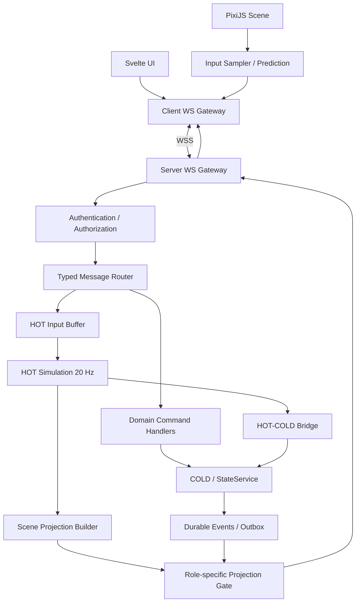

# МНЕМОСИН — NETWORK_PROTOCOL.md

**Целевая архитектура v4 · Draft 0.1**  
**Статус:** проектная спецификация для согласования и последующей реализации.  
**Назначение:** определить сетевое взаимодействие браузерного клиента Svelte/PixiJS с авторитетным сервером МНЕМОСИН, включая WebSocket lifecycle, envelopes, движение, scene replication, команды, приватность, Observer, reconnect, backpressure, безопасность и тестирование.

> Этот документ описывает целевой протокол. Он не утверждает, что протокол v4 уже реализован. Все решения помечаются как **СОГЛАСОВАНО**, **ПРЕДЛАГАЕТСЯ** или **ОТКРЫТО**. Пример payload не становится окончательной Zod-схемой без отдельной фиксации. Coding agent не должен самостоятельно закрывать открытые игровые решения.

---

## 0. Источники и область действия

### 0.1. Источники

Приоритет источников для этого документа:

1. `SYSTEM_ARCHITECTURE.md` — целевая архитектура, роли, projections, безопасность и границы модулей.
2. `HOT_COLD_DESIGN.md` — частоты, input sequence, prediction/reconciliation, scene snapshots, HOT/COLD events, ACK, recovery и метрики.
3. `WORLD_SIMULATION.md` — координаты, геометрия, interaction commands, пространственные события и read models.
4. `DOLL_AI.md` — скрытые внутренние состояния кукол и ограничения Player/Observer/Developer projections.
5. `ANDREY_AI.md` — запросы и ответы Андрея, статусы LLM, приватность, Observer и Developer projections.
6. «ЦИКЛ 48 — игровой документ (сводка решений)» — игровые каналы общения, следы, приватность и исходные названия событий.
7. Текущий код репозитория `Vekktor55/Mnemosin` — источник фактов о существующей реализации, но не основание сохранять устаревшие turn/GM-механики в целевой архитектуре.

При конфликте целевых спецификаций coding agent должен остановиться и описать конфликт, а не выбирать вариант самостоятельно. Более позднее явно согласованное решение пользователя имеет приоритет над более ранним проектным предложением.

### 0.2. Связанные документы

| Документ                 | Ответственность                                                                              |
| ------------------------ | -------------------------------------------------------------------------------------------- |
| `SYSTEM_ARCHITECTURE.md` | Общие компоненты, роли, права, верхнеуровневые границы                                       |
| `HOT_COLD_DESIGN.md`     | Семантика simulation input, HOT/COLD events, state ownership, scene snapshots и recovery     |
| `WORLD_SIMULATION.md`    | Spatial inputs/outputs, координаты, взаимодействия и геометрия                               |
| `DOLL_AI.md`             | Внутренние события и read models Doll AI                                                     |
| `ANDREY_AI.md`           | Диалоговые команды/ответы Андрея и статусы генерации                                         |
| `NETWORK_PROTOCOL.md`    | Внешний сетевой контракт клиента и сервера, авторизация, маршрутизация, delivery и reconnect |

Этот документ не дублирует внутреннюю семантику симуляции, крафта, ИИ кукол или диалогов. Он определяет, как соответствующие команды и разрешённые результаты проходят через транспорт.

### 0.3. Историческое состояние репозитория

В текущей ветке репозитория README описывает Table MVP: Svelte 5 + Vite, Fastify, нативный WebSocket, SQLite/Drizzle, а `shared/contracts` указан как источник истины Zod-схем WS/HTTP. README также описывает текущий старый WS-каталог с 28 сообщениями client→server и 35 server→client, JWT в subprotocol `mnemosin.v1.<jwt>`, WSClient с reconnect/offline queue/heartbeat и UI игрока/GM.

Это описание относится к существующей реализации и не означает, что все перечисленные старые сообщения должны сохраниться в v4. Turn Engine, GM workflow и соответствующие сообщения должны быть мигрированы/удалены согласно `SYSTEM_ARCHITECTURE.md`.

**Обязательное правило миграции:** до изменения контрактов coding agent инвентаризирует фактические схемы, handlers, gateways, tests и client WSClient в текущем репозитории. Нельзя создавать второй независимый каталог WS-сообщений.

---

# 1. Цели и не-цели протокола

## 1.1. Цели

Сетевой протокол должен:

1. Поддерживать браузерную SPA: Svelte UI + PixiJS scene.
2. Работать с авторитетной серверной HOT-симуляцией 20 Гц.
3. Давать немедленную визуальную реакцию на собственный ввод через client-side prediction.
4. Давать плавное отображение других игроков и кукол через interpolation buffer.
5. Передавать scene state отдельно от долговременных gameplay events.
6. Поддерживать COLD-команды с idempotency и явным результатом.
7. Сохранять приватность каждого игрока через серверные PlayerProjection.
8. Давать Observer полную видимость скрытого игрового состояния через отдельную ObserverProjection.
9. Отделять Observer от Developer diagnostics.
10. Поддерживать reconnect, полный resync и защиту от повторного выполнения команд.
11. Поддерживать public chat, proximity-based communication, Андрей и остальные игровые домены без обхода их серверных правил.
12. Не передавать клиенту полномочия устанавливать позиции, результаты обнаружения, скрытые роли, заражение, подлинность предметов или исходы игровых действий.
13. Быть расширяемым без создания несогласованных параллельных протоколов.

## 1.2. Не-цели

Этот документ не определяет:

- точную физику движения, ускорение и collision response;
- точные частоты send для каждого типа сущности после нагрузочных тестов;
- конкретную формулу видимости игроков в темноте;
- точную семантику whisper/private chat, пока не закрыты открытые вопросы игрового дизайна;
- полную схему каждого доменного действия крафта/инвентаря/голосования;
- backend persistence schema;
- горизонтальное масштабирование между несколькими серверами;
- голосовой чат, WebRTC или передачу аудио;
- передачу исходников или текстур карты через WebSocket.

## 1.3. Главные инварианты

- Сервер — единственный источник авторитетного игрового состояния.
- Клиент отправляет намерения/команды, а не доверенные результаты.
- Любое входящее сообщение проверяется по Zod-схеме и серверным правилам авторизации.
- Каждая COLD-команда имеет idempotency key.
- PlayerProjection, ObserverProjection и DeveloperProjection строятся отдельно на сервере.
- Ни одно сообщение, предназначенное Observer, не может попасть в Player connection.
- Scene snapshot/delta — временное состояние отображения, не Event Journal.
- Важные gameplay events нельзя coalesce/drop как устаревшие scene deltas.
- Повторная доставка команды не должна повторять игровое последствие.
- Reconnect всегда восстанавливает состояние с сервера, а не из клиентской offline-очереди.

---

# 2. Архитектура сетевого слоя

## 2.1. Высокоуровневый поток



Диаграмма показывает логические границы. Она не требует отдельного микросервиса для каждого блока.

## 2.2. Клиентские части

- `WSClient` — соединение, reconnect, heartbeat, общая маршрутизация и transport errors.
- `InputSampler` — сбор локального ввода движения.
- `LocalPrediction` — мгновенное визуальное предсказание собственного персонажа.
- `SceneReplicationClient` — применение keyframes/deltas и interpolation buffer.
- `DomainMessageHandlers` — распределение chat, interaction, inventory, crafting, Andrew и других доменных сообщений в соответствующие stores/services.
- Svelte stores — UI read models, не источник игровой истины.
- PixiJS renderer — отрисовка текущего presentation state.

Клиент не реализует авторитетные игровые решения. LocalPrediction — UX-компонент, а не серверная симуляция.

## 2.3. Серверные части

- `WsGateway` — upgrade, connection lifecycle, ограничение входящих payload, отправка/закрытие.
- `ConnectionRegistry` — учёт активных соединений и их actor context.
- `AuthenticationService` — подтверждение пользовательской/сессионной идентичности.
- `AuthorizationPolicy` — доступ actor к конкретному match и projection.
- `MessageRouter` — dispatch по discriminated union.
- `InputGateway` — проверка/буферизация movement input.
- `CommandGateway` — передача COLD-команд в соответствующие application services.
- `SceneReplicationService` — keyframes/deltas по разрешённым projections.
- `ProjectionBuilder` — Player/Observer/Developer projections.
- `DeliveryQueue` — backpressure, coalescing временного состояния, доставка важных сообщений.

Конкретная структура файлов остаётся в ответственности `SYSTEM_ARCHITECTURE.md` и текущей модульной архитектуры. Не создавать второй composition root.

---

# 3. Транспорт и версия протокола

## 3.1. Транспорт

**СОГЛАСОВАНО:** браузерный клиент связывается с Node.js/Fastify сервером через WebSocket. Для production используется защищённое соединение WSS.

HTTP остаётся транспортом для:

- первичной аутентификации/получения игровых данных, если это предусмотрено текущими endpoints;
- загрузки статических World Pack/assets;
- health/diagnostics endpoints, доступных соответствующей роли;
- иных request/response операций, которые не требуют realtime push.

WebSocket используется для:

- realtime movement input и scene replication;
- game commands и command results;
- chat/proximity communication;
- event notifications и projection updates;
- heartbeat и reconnect/resync;
- Observer scene/projection updates.

## 3.2. WebSocket subprotocol

В текущем репозитории README указывает handshake subprotocol вида `mnemosin.v1.<jwt>`.

Для миграции:

1. Coding agent должен проверить реальный текущий handshake и его tests.
2. Не менять способ аутентификации одновременно с миграцией игровых message schemas без отдельного решения.
3. Если JWT остаётся в subprotocol, секрет должен быть исключён из логов, ошибок, trace spans и диагностических событий.
4. Сервер обязан проверять `Origin` по allowlist, срок действия JWT, audience/issuer (если они определены текущей системой) и membership в партии.
5. Запрещено помещать токен в URL/query string.

**ОТКРЫТО:** сохранить `mnemosin.v1.<jwt>` или перейти на безопасный одноразовый WS ticket / same-origin cookie flow. Это отдельное security decision. Coding agent не должен менять handshake самостоятельно.

## 3.3. Версия протокола

Рекомендуемая модель:

- WebSocket subprotocol major version — несовместимые изменения transport contract;
- `schemaVersion` внутри критичных payload/envelopes — версионирование конкретной схемы;
- `protocolFeatures` — необязательная capability negotiation для совместимых дополнительных возможностей.

Пример идентификатора: `mnemosin.v1`.

Не повышать major version при каждом добавлении необязательного поля. Не принимать неизвестный critical message type как безвредный.

## 3.4. Совместимость клиента и сервера

После аутентификации сервер сообщает:

- `protocolVersion`;
- `serverBuild`/`serverVersion` (техническая версия, без секретов);
- поддерживаемые features;
- допустимые `schemaVersion` для используемых каталогов;
- `matchId` и `connectionId`, когда контекст установлен.

При несовместимой major version сервер отклоняет соединение с машинно-читаемой ошибкой. Точный UX-текст задаёт клиент.

---

# 4. Аутентификация, actor context и жизненный цикл соединения

## 4.1. Actor context

Каждое принятое соединение после авторизации получает серверный context:

```ts
interface ConnectionActorContext {
  connectionId: string;
  actorId: string;
  actorType: 'player' | 'observer' | 'developer';
  matchId: string;
  sessionId: string;
  connectionEpoch: number;
  projectionKind: 'player' | 'observer' | 'developer';
  permissions: string[];
}
```

Это концептуальная модель. Конкретный тип должен использовать реальные существующие `Session`/`Match`/`User` IDs и capability model репозитория. Не добавлять дублирующие идентификаторы, если аналогичные уже существуют.

Критично:

- `actorId`, `actorType`, `matchId`, `permissions` определяются сервером;
- клиент не может прислать `actorType: observer` и тем самым получить observer access;
- playerId для movement/chat/interactions берётся из authenticated actor context;
- идентификаторы в payload используются только как target/reference и проверяются по разрешениям.

## 4.2. Connect lifecycle

Предлагаемый логический lifecycle:

1. Browser получает валидные session credentials через установленный HTTP/auth flow.
2. Browser открывает WebSocket на same-origin endpoint.
3. Сервер проверяет handshake/subprotocol, Origin, auth, rate limits и доступ к requested session/match.
4. Сервер создаёт `connectionId` и `connectionEpoch`.
5. Сервер связывает соединение с actor context.
6. Сервер отправляет `connection:welcome`.
7. Клиент отправляет `connection:client-ready` после регистрации message handlers и подготовки к keyframe.
8. Сервер отправляет role-specific initial projection и полный `scene:keyframe` (или упорядоченную пару сообщений с явным barrier/revision).
9. Клиент подтверждает получение и применение начального состояния отдельным sync acknowledgement либо протокольным barrier, выбранным в реализации.
10. Сервер отправляет `connection:ready`; соединение переходит в `ready`.
11. Начинаются scene deltas и domain notifications.

**ПРЕДЛАГАЕТСЯ:** initial state barrier должен задавать `projectionRevision` и `sceneSequence`, чтобы клиент не применил старый keyframe после более нового domain event.

## 4.3. Состояния connection

Минимальные серверные состояния:

- `unauthenticated` — upgrade выполнен, auth не завершена;
- `authenticating`;
- `awaiting_client_ready`;
- `syncing` — отправка initial projection/keyframe;
- `ready`;
- `closing`;
- `closed`.

Не передавать игровую команду до состояния `ready`, кроме сообщений, прямо разрешённых handshake lifecycle.

## 4.4. Несколько вкладок/соединений

**ОТКРЫТО:** разрешены ли несколько одновременных player connections для одного игрового персонажа.

До решения система должна:

- не считать `connectionId` равным `playerId`;
- не позволять двум соединениям создавать конфликтующие input streams без явной policy;
- иметь способ инвалидировать старый controlling connection при выдаче нового lease, если выбран режим single-controller;
- не удалять match actor только из-за закрытия одного socket, если у него остаётся другое валидное соединение.

---

# 5. Общий формат сообщений

## 5.1. Envelope

Все WebSocket-сообщения должны быть типизированы и иметь общий формат.

Рекомендуемая концепция:

```ts
interface WsEnvelope<TType extends string, TPayload> {
  protocolVersion: 'v1';
  type: TType;
  messageId: string;
  matchId?: string;
  payload: TPayload;
}
```

Внутри конкретных payload могут быть `schemaVersion`, `commandId`, `eventId`, `sceneSequence`, `simulationTick` или другие domain-specific metadata.

Не дублировать `actorId`/`role` в клиентских командах: они определяются сервером из context.

`clientSentAt` может добавляться только для диагностики и не является источником игрового времени.

## 5.2. Разделение идентификаторов

Не смешивать следующие значения:

| Идентификатор        | Назначение                                                                                             |
| -------------------- | ------------------------------------------------------------------------------------------------------ |
| `messageId`          | Уникальная конкретная транспортная отправка/сообщение                                                  |
| `commandId`          | Идемпотентный ID действия, которое может быть повторено после retry                                    |
| `inputSequence`      | Порядковый номер movement input в одном input stream                                                   |
| `inputStreamId`      | Идентификатор потока ввода/connection epoch                                                            |
| `sceneSequence`      | Порядковый номер scene replication update для projection/connection                                    |
| `baseSceneSequence`  | Последняя версия, относительно которой построена delta                                                 |
| `simulationTick`     | Авторитетный номер HOT tick                                                                            |
| `eventId`            | Стабильный ID durable gameplay event                                                                   |
| `eventSequence`      | Порядок durable events в пределах match/world epoch                                                    |
| `projectionRevision` | Версия COLD projection или domain read model                                                           |
| `worldEpoch`         | Версия активного экземпляра/состояния игрового мира, необходимая для invalidation старых scene streams |
| `connectionEpoch`    | Поколение соединения/управляющего input stream                                                         |

Идентификаторы не должны использоваться взаимозаменяемо.

## 5.3. Correlation

Для связанных действий можно передавать `correlationId` и `causationId` в диагностическом/event envelope.

Они помогают связать:

- пользовательскую команду;
- серверное решение;
- HOT событие;
- COLD commit;
- projection update;
- ответ клиенту.

Correlation metadata не заменяет `commandId` или `eventId`.

## 5.4. Формат ошибок

Все ошибки должны возвращаться в едином машиночитаемом envelope:

```ts
interface WsErrorPayload {
  code: string;
  messageKey: string;
  retryable: boolean;
  correlationId?: string;
  relatedMessageId?: string;
  relatedCommandId?: string;
  details?: Record<string, unknown>;
}
```

`details` не должен содержать секреты, скрытые роли, внутренние belief state Андрея или неразрешённые наблюдателю данные.

Рекомендуемые группы кодов:

- `AUTH_*` — auth/session/permission;
- `PROTOCOL_*` — неизвестный type, unsupported version, invalid envelope;
- `RATE_LIMITED` — rate limit;
- `MATCH_*` — отсутствующая/закрытая/неподходящая партия;
- `INPUT_*` — невалидный или устаревший movement input;
- `COMMAND_*` — конфликт/отказ доменной команды;
- `RESYNC_REQUIRED` — клиентская scene state больше не может быть обновлена дельтами;
- `SERVER_BUSY` — временная перегрузка;
- `INTERNAL_ERROR` — безопасное обобщённое сообщение.

Список кодов должен стать частью общего `ERROR_TABLE`/контрактов. Не создавать второй разрозненный словарь ошибок.

---

# 6. Каталог типов сообщений

## 6.1. Client → Server

Минимальный целевой каталог логических типов:

| Type                      | Назначение                                       | Semantics                                        |
| ------------------------- | ------------------------------------------------ | ------------------------------------------------ |
| `connection:client-ready` | Клиент закончил подготовку handlers              | Однократно на connection lifecycle               |
| `connection:ping`         | Application heartbeat/RTT sample                 | Эфемерное, периодическое                         |
| `scene:input`             | Movement intent                                  | Частое, sequence-ordered, latest-state semantics |
| `scene:resync`            | Запрос keyframe после пропуска/несогласованности | Идемпотентное чтение состояния                   |
| `interaction:command`     | Взаимодействие со светом/дверью/укрытием и т. п. | Idempotent command                               |
| `chat:send`               | Публичное/пространственное сообщение             | Durable/domain command по правилам Chat          |
| `andrew:ask`              | Запрос к Андрею                                  | Idempotent request с async status/result         |
| `domain:command`          | Остальные разрешённые COLD actions               | Только discriminated union allowlist             |
| `observer:command`        | Разрешённое вмешательство Бога                   | Capability-protected, audited, idempotent        |

Наличие сообщения не означает, что все соответствующие игровые функции уже реализованы. Каталог будет расширяться отдельными domain specs.

## 6.2. Server → Client

| Type                    | Назначение                                     | Projection / delivery                                                            |
| ----------------------- | ---------------------------------------------- | -------------------------------------------------------------------------------- |
| `connection:welcome`    | Результат подключения и capability negotiation | Actor-specific                                                                   |
| `connection:ready`      | Initial sync completed                         | Actor-specific                                                                   |
| `connection:pong`       | Heartbeat response                             | Только отправитель ping                                                          |
| `connection:error`      | Ошибка protocol/connection                     | Actor-specific, без скрытых данных                                               |
| `scene:keyframe`        | Полное состояние активной сцены                | Player или Observer projection                                                   |
| `scene:delta`           | Компактное изменение сцены                     | Player или Observer projection                                                   |
| `scene:input-ack`       | Подтверждение обработанного input              | Только controlling actor                                                         |
| `scene:resync-required` | Требуется полная синхронизация                 | Только соответствующее соединение                                                |
| `command:result`        | Результат COLD command                         | Только actor, отправивший команду (кроме отдельно определённых broadcast events) |
| `domain:event`          | Разрешённое событие домена                     | Targeted projection / audience                                                   |
| `chat:message`          | Новая доступная реплика                        | Audience из server privacy policy                                                |
| `chat:delivery`         | Статус сохранения/доставки сообщения           | Отправитель и/или адресат по правилам Chat                                       |
| `andrew:status`         | accepted/queued/completed/fallback status      | Запросивший игрок; Observer видит расширенный статус в своей projection          |
| `andrew:reply`          | Реплика Андрея                                 | Только разрешённая аудитория                                                     |
| `match:projection`      | Изменение COLD read model состояния партии     | Role-specific                                                                    |
| `observer:projection`   | Полная скрытая игровая projection              | Только Observer                                                                  |
| `developer:diagnostic`  | Техническая диагностика                        | Только Developer Mode                                                            |

Список может быть нормализован до меньшего числа `type`, если discriminated payload и права остаются строго типизированы. Нельзя ради сокращения количества типов смешивать несопоставимые security scopes.

## 6.3. Namespacing

Рекомендуемые префиксы:

- `connection:*` — lifecycle/heartbeat;
- `scene:*` — HOT scene replication;
- `interaction:*` — действия с объектами;
- `chat:*` — разговоры;
- `andrew:*` — Андрей;
- `domain:*` — COLD game domains;
- `observer:*` — Observer;
- `developer:*` — diagnostics.

Не возвращать `TURN_*` сообщения и не вводить `turn:*` namespace. Turn Engine удалён в целевой v4.

---

# 7. Movement input protocol

## 7.1. Принцип

Клиент отправляет намерение двигаться. Сервер сам рассчитывает итоговые координаты и скорость.

Недопустимо принимать от игрока:

- авторитетную конечную позицию;
- скорость выше допустимой;
- факт прохождения сквозь препятствие;
- результат столкновения;
- факт уклонения от куклы.

## 7.2. Input sequence

Каждое input сообщение содержит:

- `inputStreamId` — ID текущего потока ввода;
- `inputSequence` — возрастающий целый номер;
- `input` — нормализованное намерение движения и разрешённые удерживаемые действия;
- необязательный `clientSentAt` только для diagnostics.

Семантика:

1. `inputSequence` возрастает в пределах одного `inputStreamId`.
2. Сервер отвергает повторные/устаревшие sequence.
3. Пропуск sequence не обязательно означает потерю игрового действия: movement input отражает актуальное удерживаемое состояние, а не отдельную одноразовую команду.
4. При новом connection epoch создаётся новый `inputStreamId`.
5. После reconnect старые input packets не воспроизводятся.
6. Отпускание клавиши/прекращение движения должно передаваться явно.
7. При прекращении свежих input updates сервер сбрасывает движение после `inputLeaseTimeout`.

**ОТКРЫТО:** точная длительность `inputLeaseTimeout` определяется прототипом и jitter testing.

## 7.3. Форма input payload

`HOT_COLD_DESIGN.md` оставляет выбор между удерживаемым направлением, velocity intent, click-to-move или комбинацией открытым. Поэтому данный документ фиксирует только семантику, но не окончательный набор полей.

Проектная рекомендация для первого теста — удерживаемый нормализованный вектор движения с отдельным признаком sprint/режима, если он нужен игровому дизайну.

Coding agent не должен реализовывать click-to-move или альтернативные формы ввода без явного выбора. Конкретная форма должна быть закрыта через HC-02 в `HOT_COLD_DESIGN.md` до фиксации финальной Zod-схемы.

## 7.4. Частота отправки

**ПРЕДЛАГАЕТСЯ:** клиент отправляет актуальное состояние movement input примерно 20 раз в секунду во время удержания ввода и немедленно при важных изменениях состояния (например, начало/остановка движения). Это начальная настройка, а не SLA.

Нельзя отправлять сообщение на каждый визуальный кадр 60/120 FPS без доказанной необходимости.

## 7.5. Server validation

На сервере проверяются:

- actor имеет active player control;
- actor находится в состоянии, допускающем движение;
- `inputStreamId` совпадает с активным;
- sequence не устарел и не повторяется;
- значения и типы input находятся в допустимом диапазоне;
- входящая частота не превышает abuse limits;
- движение совместимо с актуальной геометрией и состоянием мира.

## 7.6. Input acknowledgement

Сервер включает в scene snapshot или отдельный `scene:input-ack`:

- `inputStreamId`;
- `lastProcessedInputSequence`;
- `simulationTick`;
- актуальную authoritative position/velocity собственного персонажа.

ACK подтверждает применение input к симуляции, а не гарантирует визуальное совпадение клиента с сервером.

---

# 8. Client-side prediction и remote interpolation

## 8.1. Разделение частот

- HOT simulation: 20 Гц, fixed `dt = 50 ms` — согласованная целевая частота.
- Scene network updates: начально до 20 Hz для активной динамической сцены — проектное предложение из HOT/COLD.
- PixiJS render loop: независим от сети, целевой 60 FPS или выше в пределах возможностей устройства.

Эти частоты не должны искусственно синхронизироваться.

## 8.2. Local prediction

Для собственного персонажа:

1. Клиент считывает input.
2. Немедленно визуально обновляет predicted position.
3. Отправляет input с sequence.
4. Получает authoritative snapshot/ACK.
5. Устанавливает серверную authoritative позицию как baseline.
6. Удаляет все inputs до `lastProcessedInputSequence` включительно.
7. Переигрывает оставшиеся unacknowledged inputs поверх baseline.
8. Применяет visual correction без прохода сквозь препятствия.

Local prediction не позволяет совершить игровое действие без серверной проверки.

## 8.3. Reconciliation

Малые отклонения могут сглаживаться по нескольким кадрам. Большие ошибки, вызванные столкновением, закрытой дверью, захватом или сменой пространственного состояния, должны корректироваться быстро и явно.

Не сглаживать correction через стены или закрытые двери.

Точные пороги correction — открытый параметр для прототипа.

## 8.4. Remote interpolation

Для других игроков и кукол клиент хранит ring buffer scene snapshots.

Алгоритм:

1. Получить snapshot с `simulationTick` и `sceneSequence`.
2. Проверить sequence continuity.
3. Добавить состояние в буфер сущности.
4. Оценить server time по heartbeat/tick mapping.
5. Выбрать render time примерно на `interpolationDelay` позади оценённого server time.
6. Найти два состояния, окружающих render time.
7. Интерполировать позицию и разрешённые presentation свойства.
8. Применять дискретные state transitions отдельно.

**ПРЕДЛАГАЕТСЯ:** стартовая задержка interpolation buffer около 100 мс (примерно два 20 Hz интервала). Это не окончательное значение; адаптация зависит от измеренного RTT/jitter.

## 8.5. Экстраполяция

Если snapshot задержан, допускается короткая ограниченная экстраполяция по последней известной velocity, после чего сущность удерживается в последнем подтверждённом положении.

Нельзя долго экстраполировать движение куклы/игрока: это может показать прохождение сквозь дверь, захват или смену состояния, которые сервер уже обработал иначе.

## 8.6. Дискретные переходы

Не интерполировать как обычное движение:

- открытие/закрытие двери;
- вход/выход в укрытие;
- захват;
- перенос в Детскую;
- смену этажа/world epoch;
- смену состояния жизни/контроля персонажа;
- появление/исчезновение сущности по privacy/visibility rules.

Их визуальная анимация может быть плавной, но момент игрового перехода определяется серверным событием.

---

# 9. Scene replication: keyframes и deltas

## 9.1. Назначение

Scene replication передаёт актуальное разрешённое состояние сцены для рендеринга. Это не event sourcing и не журнал партии.

Клиент не должен пытаться восстановить истину, проигрывая все ранее полученные scene deltas.

## 9.2. Keyframe

Полный `scene:keyframe` отправляется:

- при первичной готовности соединения;
- при reconnect/resync;
- при смене этажа/world epoch;
- при обнаружении sequence gap, когда delta replay невозможен;
- периодически по выбранной политике, если это нужно для устойчивости.

Концептуальный payload:

```ts
interface SceneKeyframePayload {
  matchId: string;
  worldEpoch: number;
  snapshotId: string;
  sceneSequence: number;
  simulationTick: number;
  serverTimeMs: number;
  projectionRevision: number;
  worldPackVersion: string;
  ownActorState?: OwnActorSceneState;
  entities: ProjectedSceneEntity[];
  objects: ProjectedSceneObject[];
  environment: ProjectedEnvironmentState;
  lastProcessedInputSequence?: number;
  inputStreamId?: string;
}
```

Все `Projected*` types различаются для Player и Observer projections. Нельзя сериализовать full internal entity and затем рассчитывать, что клиент сам скроет запрещённые поля.

## 9.3. Delta

Концептуальный payload:

```ts
interface SceneDeltaPayload {
  matchId: string;
  worldEpoch: number;
  sceneSequence: number;
  baseSceneSequence: number;
  simulationTick: number;
  serverTimeMs: number;
  projectionRevision: number;
  entityUpserts: ProjectedSceneEntity[];
  entityRemovals: string[];
  objectUpserts: ProjectedSceneObject[];
  objectRemovals: string[];
  environmentPatch?: Partial<ProjectedEnvironmentState>;
  ownActorState?: OwnActorSceneState;
  lastProcessedInputSequence?: number;
  inputStreamId?: string;
}
```

Delta применяется только если:

- `worldEpoch` совпадает с активным;
- `baseSceneSequence` равен последней применённой sequence;
- schema/projection version поддерживается;
- payload прошёл валидацию.

В противном случае клиент отправляет `scene:resync` и не пытается самостоятельно восстановить пропущенные изменения.

## 9.4. Scene sequence

`sceneSequence` монотонен в рамках одного scene stream (match + worldEpoch + projection stream/connection scope).

Игрок и наблюдатель могут получать различающиеся payload для одного simulation tick. Не следует ожидать, что их sequence и количество entities совпадают.

## 9.5. Удаление сущности

`entityRemovals` не означает смерть или удаление сущности из мира. Причина может быть:

- entity вышла из разрешённой области видимости PlayerProjection;
- actor перешёл в другой world space;
- объект больше не должен быть представлен этой projection;
- произошёл фактический игровой переход, описанный отдельным domain event.

Клиент не должен выводить скрытую роль или событие по одному факту исчезновения сущности.

## 9.6. Частота отправки

**ПРЕДЛАГАЕТСЯ:** до 20 scene updates/s для активного движения. Неподвижные сущности и статические данные не нужно повторять на каждом обновлении. Точные throttling/interest rules зависят от measurements.

## 9.7. Статические World Pack данные

Не отправлять через каждое scene delta:

- фоны комнат;
- tile maps;
- collision geometry целиком;
- Blender renders/atlases;
- неизменяемые описание комнат и статику контента.

Статические данные загружаются по version/hash через отдельный asset/content flow. Сервер подтверждает совместимую `worldPackVersion` в keyframe. При несовпадении клиент запрашивает корректную версию до начала normal scene rendering.

---

# 10. Приватность и projections

## 10.1. Серверная фильтрация обязательна

Запрещено отправлять единый полный объект мира всем соединениям и скрывать запрещённые поля средствами Svelte/PixiJS.

Перед сериализацией сообщения сервер применяет конкретную projection policy:

- `PlayerProjection`;
- `ObserverProjection`;
- `DeveloperProjection`.

## 10.2. PlayerProjection

PlayerProjection содержит только данные, которые конкретный игрок может получать по игровым правилам.

Минимальные запреты:

- истинная роль другого игрока;
- скрытый флаг заражения;
- скрытое качество/подлинность предмета, пока не раскрыто механикой;
- скрытые тайные цели;
- скрытые сенсорные сведения кукол;
- внутренние сообщения/координация кукол;
- belief store Андрея;
- полная история приватных разговоров других участников;
- Observer/Developer diagnostics.

Допустимость передачи позиции другого игрока зависит от пространственных/visibility rules, а не только от факта соединения с match.

## 10.3. ObserverProjection

**СОГЛАСОВАНО пользователем:** Observer видит всё скрытое игровое состояние партии.

Это включает, если соответствующие данные существуют:

- все роли и заражение;
- все позиции игроков и кукол;
- hidden player/object state;
- реальную подлинность/порчу предметов;
- private messages и их аудиторию;
- контакты и следы;
- тайные цели;
- полное внутреннее игровое состояние кукол, их наблюдения/память/координацию;
- фактические параметры сценария и seed;
- актуальные beliefs/trust state Андрея;
- события крафта и действительные результаты;
- состояние дверей, света, газа, укрытий и станций;
- вмешательства наблюдателя.

ObserverProjection не должна раскрывать секреты инфраструктуры: API keys, JWT signing secret, private keys, env secrets, database credentials, provider credentials и иные security secrets.

Observer не получает несуществующее «скрытое рассуждение» LLM. Он видит только сохранённые system facts, beliefs, prompt/request metadata, provider result fields и developer diagnostics, которые отдельно разрешены Developer role.

## 10.4. DeveloperProjection

DeveloperProjection — отдельный доступ для разработчика/администратора в debug/test environment.

Может включать:

- техническую трассировку;
- handler errors;
- timing/queue metrics;
- safe prompt context snapshot;
- модель и провайдер, latency/token counters;
- schema validation failures;
- deterministic replay metadata;
- GM Review test artifacts;
- raw provider output после redaction.

DeveloperProjection не должна открывать production secrets через WebSocket.

## 10.5. Projection isolation

Правила:

1. Отдельные DTO/schema для каждой projection.
2. Отдельные builders/serializers или один строго typed projection builder с явной веткой actor type.
3. Никакого `JSON.stringify(fullGameState)` в player connection.
4. Никакого клиентского `if (isObserver) showHiddenFields` как единственного security barrier.
5. Projection policy тестируется на реальных serialized payload, а не только на UI.
6. Передача ObserverProjection в player connection — критическая security regression.

## 10.6. Observer commands

Просмотр и вмешательство — разные capabilities.

Observer получает read access ко всей скрытой игровой информации, но не получает автоматическое право менять всё состояние.

Любые God Actions передаются через `observer:command` и проверяются сервером по permission/capability. Команда должна иметь `commandId`, actor context, target, разрешённое действие и correlation metadata.

После commit сервер рассылает результат по соответствующим projections. Действие записывается как `actorType=observer`, не меняя историю задним числом.

Точный каталог God Actions остаётся в `SYSTEM_ARCHITECTURE.md`/отдельной спецификации Observer.

---

# 11. Interaction protocol

## 11.1. Общая команда

Взаимодействия с дверями, источниками света, укрытиями и объектами — COLD commands, которые могут приводить к COLD→HOT runtime updates.

Концептуальная форма:

```ts
interface InteractionCommandPayload {
  commandId: string;
  targetId: string;
  action: string;
  expectedObjectRevision?: number;
  parameters?: Record<string, unknown>;
}
```

В окончательном контракте `action` должен быть discriminated union, не произвольная строка. `parameters` должны быть строго типизированы для каждой action; generic record допустим только как иллюстрация, не как production schema.

## 11.2. Серверная проверка

Сервер проверяет:

- authenticated actor context;
- membership/permission;
- существование объекта в актуальном world epoch;
- расстояние по авторитетной позиции на выбранном tick;
- допустимость action для текущего состояния;
- ограничения игрока (Captured, Stasis, etc.);
- object revision/version при необходимости;
- конкурирующие команды и capacity;
- rate limits и idempotency.

Клиент не сообщает серверу, что команда прошла успешно.

## 11.3. Command result

Результат должен содержать:

- `commandId`;
- статус `accepted`/`rejected`/`conflict`/`already_processed`;
- `resultCode`;
- актуальную object revision или state reference при необходимости;
- `projectionRevision`/related event id при commit.

Не отправлять скрытые причины отказа, если они раскрывают тайные игровые факты.

## 11.4. Доступные категории взаимодействий

На текущем этапе согласованы базовые категории:

- включить/выключить источник света;
- открыть/закрыть дверь;
- войти/выйти из укрытия.

Другие команды (крафт, использование предмета, записки, сканер, проявитель, детектор и т. п.) добавляются в соответствующих доменных спецификациях через тот же command pattern.

## 11.5. Одновременные команды

Сервер сериализует/разрешает конкуренцию по доменным правилам. Примеры:

- два игрока одновременно взаимодействуют с одной дверью;
- два игрока занимают последнее место в укрытии;
- игрок двигается во время попытки взаимодействия;
- дверь закрывается при занятом проходе.

Command result возвращает победившее состояние/конфликт. Клиент не должен самостоятельно угадывать порядок.

---

# 12. Chat, whisper, private communication и traces

## 12.1. Общее правило

Чат — COLD/domain subsystem. HOT предоставляет только spatial facts, необходимые для проверки допустимости proximity communication.

Клиент не выбирает список получателей произвольным образом и не решает, кто слышит сообщение. Сервер строит audience по правилам Chat/Privacy.

## 12.2. Команда отправки

Концептуальный контракт:

```ts
interface ChatSendPayload {
  commandId: string;
  mode: 'public' | 'whisper' | 'private';
  recipientId?: string;
  content: string;
  clientMessageId?: string;
}
```

`mode` отражает продуктовую концепцию, но точная семантика каждого режима должна совпадать с утверждённой матрицей приватности. Если режимы ещё не реализованы/не согласованы, не следует создавать фиктивные права доставки.

## 12.3. Server validation

Сервер проверяет:

- пользователь является активным actor в match;
- размер/формат/допустимость текста;
- message rate limits;
- право отправлять в выбранный mode;
- если канал пространственный — актуальную дистанцию, один и тот же floor/world space и другие условия из Privacy Policy;
- корректность адресата и его доступность;
- статус actor (например, Captured/разрешённые специальные каналы);
- idempotency по `commandId`/message ID.

Нельзя доверять клиентскому полю `recipientIds` или `audience`.

## 12.4. Audience

Audience вычисляется сервером и может включать:

- всех игроков текущей партии;
- игроков в допустимой пространственной зоне;
- единственного адресата;
- специальных recipients по игровой механике;
- Observer.

Observer может видеть полный игровой факт приватной коммуникации согласно согласованной omniscient projection. Обычные игроки получают только ту часть, которую разрешает матрица приватности.

## 12.5. Открытые игровые решения

Не закрыты автоматически этим протоколом:

- слышат ли whisper все в радиусе или только адресат;
- виден ли другим игрокам визуальный факт whisper;
- видно ли содержание, имя адресата или только признак контакта;
- какие расстояния соответствуют whisper/private;
- может ли Captured отправить специальный whisper в рамках «шёпота кукол»;
- точная доступность общего чата по этажам.

Пока решения не зафиксированы, протокол должен поддерживать серверно-рассчитанную audience policy, не hardcode-ить окончательные радиусы и не отдавать адресатам лишнюю информацию.

## 12.6. Chat delivery

Для сохранённого сообщения сервер возвращает `chat:delivery`/`command:result` с окончательным message ID и статусом commit.

Повтор после reconnect с тем же idempotency key не создаёт дубль.

Если пользователь получает приватную реплику, она отправляется только его authorized connection(s) и Observer projection. Не использовать broadcast с клиентским скрытием.

## 12.7. Physical notes и recordings

Физические записки, диктофон, радиостанция и другие предметы не превращаются в отдельный сетевой обход privacy rules. Их действия идут через доменные commands; сервер проверяет владение, положение, доступность, память устройства и определяет, какие данные получает игрок.

---

# 13. Domain command protocol

## 13.1. Общий command pattern

Дискретные игровые действия идут через COLD command handlers. Каждый command:

- имеет уникальный `commandId`;
- связан с authenticated actor context;
- проходит schema validation;
- проходит authorization;
- проверяет актуальность игрового state/revision;
- выполняет мутацию через существующий `StateService`;
- фиксирует durable event/outbox в согласованной транзакционной границе;
- возвращает `command:result` инициатору;
- публикует role-specific domain projection updates.

## 13.2. Не создавать универсальный небезопасный command API

Запрещён контракт вида:

```ts
{
  type: string;
  payload: any;
}
```

который позволяет клиенту прислать произвольный domain action.

Если применяется единый транспортный `domain:command`, его `payload` должен быть compile-time discriminated union зарегистрированных команд с отдельными Zod schemas. Неизвестный command type отклоняется.

## 13.3. Категории доменных команд

В дальнейшем будут зарегистрированы команды по bounded contexts:

- inventory / item transfer;
- crafting;
- scanner / detector / developer / recorder interactions;
- notes / documents;
- voting / floor transition / leave-behind decisions;
- capture / rescue / Children room actions;
- Andrew interaction;
- observer God Actions.

Этот документ не придумывает все payload для этих подсистем. Их схемы должны определяться в соответствующих спецификациях и `shared/contracts`.

## 13.4. Ошибки и конфликты

Отказ из-за игрового состояния — ожидаемый результат, а не `INTERNAL_ERROR`.

Примеры machine-readable outcomes:

- `OUT_OF_RANGE`;
- `INVALID_OBJECT_STATE`;
- `NOT_AUTHORIZED`;
- `TARGET_UNAVAILABLE`;
- `CAPACITY_REACHED`;
- `STALE_REVISION`;
- `ALREADY_PROCESSED`;
- `MATCH_NOT_ACTIVE`.

Точные коды должны находиться в едином ERROR_TABLE и быть согласованы с текущим стилем контрактов.

---

# 14. Андрей: realtime protocol boundary

## 14.1. Запрос

Игрок отправляет `andrew:ask` с idempotent request ID/command ID и текстом вопроса или разрешённым типом взаимодействия.

Клиент не отправляет:

- beliefs Андрея;
- доверие Андрея;
- скрытые факты;
- выбранную модель/провайдера;
- system prompt;
- token budget;
- request context, который должен формировать сервер.

## 14.2. Async lifecycle

Рекомендуемые статусы:

- `accepted` — запрос прошёл начальную проверку;
- `queued` — ожидает обработки;
- `generating` — LLM request выполняется;
- `completed` — ответ готов;
- `fallback` — ответ сформирован резервным сценарием;
- `rejected` — запрос отклонён по игровой/технической причине.

Точные статусы согласовать с `ANDREY_AI.md` и не дублировать конкурирующие enum.

## 14.3. Ответ

`andrew:reply` доставляется только разрешённой аудитории. Player получает текст реплики и минимальный игровой delivery status. Observer получает соответствующую сохранённую belief/interaction projection. Developer diagnostics передаются отдельно.

## 14.4. Timeout и disconnect

LLM generation не должна блокировать HOT tick или общую очередь scene replication.

Если игрок отключился:

- генерация может продолжиться согласно политике `ANDREY_AI.md`;
- при завершении сервер проверяет, что запрос ещё актуален и actor/audience валидны;
- ответ не отправляется по старому socket;
- после reconnect игрок получает только актуальное разрешённое состояние/ответ.

Политика продолжения или отмены generation при disconnect — согласовывается в `ANDREY_AI.md`.

---

# 15. Observer protocol

## 15.1. Отдельная actor role

Observer подключается как отдельный actor type и не занимает player slot.

Он получает собственную ObserverProjection с полной видимостью скрытого игрового состояния.

## 15.2. Read channel

Observer получает:

- scene keyframes/deltas со всеми сущностями и скрытыми игровыми полями;
- полные game-state/domain projections;
- приватные сообщения и факты контактов;
- скрытые роли/предметы/цели;
- внутреннее состояние кукол и их coordination data;
- фактическое состояние/убеждения Андрея, существующие в game state;
- журнал значимых игровых событий.

Не получает инфраструктурные секреты или скрытое chain-of-thought модели.

## 15.3. God Actions

Observer command path отделён от read stream:

```text
Observer UI
   ├── ObserverProjection (read-only data)
   └── observer:command
          └── Permission check
                └── Domain command handler
                      └── StateService / HOT update
                            └── Audit event
```

Все команды должны проверяться по отдельным permissions/capabilities. Полная видимость не даёт implicit write permission.

## 15.4. Аудит

Каждое вмешательство записывает:

- `actorId`/observer id;
- `commandId`;
- action type;
- target;
- accepted/rejected outcome;
- correlation ID;
- authoritative timestamp/revision;
- committed result reference.

Не позволять Observer менять прошлую историю. Он может изменить будущее состояние разрешённой командой, но действие остаётся видимым в audit trail.

## 15.5. Несколько observers

**ОТКРЫТО:** допустимо ли более одного Observer на партию и допускается ли одновременно read-only и interactive Observer. Протокол не должен предполагать единственного connection как единственное представление Observer.

---

# 16. Heartbeat, latency и connection health

## 16.1. Heartbeat

Нужен heartbeat для:

- оценки RTT;
- поддержания active connection;
- обнаружения мёртвого connection;
- оценки server time относительно client time для interpolation.

В браузере WebSocket API не предоставляет JS-коду прямой отправки protocol-level Ping frame. Поэтому можно использовать application-level `connection:ping` / `connection:pong`, либо серверные websocket ping frames с отдельным application-level time sync.

**ПРЕДЛАГАЕТСЯ:** начать с application-level ping containing `pingId` и local timestamp; сервер отвечает тем же `pingId`, `serverTimeMs` и текущим `simulationTick`. Client timestamp — только измерительный сигнал, не игровое время.

## 16.2. Timeout

Конкретные интервалы heartbeat/timeout должны быть конфигурируемыми и выбираться по тестам. Не объявлять произвольное число нормативом без прототипа.

Если heartbeat timeout превышен:

- connection помечается degraded/closing;
- закрывается соответствующим образом;
- game actor переходит в disconnect handling policy;
- при reconnect выполняется полноценный resync.

## 16.3. Не путать connection health с player state

WebSocket closed не обязательно означает, что игрок покинул партию. Уход/AFK/перевод персонажа в безопасное состояние регулируется отдельной match disconnect policy.

Эта policy остаётся открытой и не должна быть импровизирована транспортным handler.

---

# 17. Reconnect и resynchronization

## 17.1. Общая стратегия

После reconnect клиент не продолжает доверять старому локальному состоянию.

Последовательность:

1. Клиент выполняет backoff retry с jitter.
2. Повторно аутентифицируется текущими credentials.
3. Создаёт новый socket и новый `connectionEpoch`/`inputStreamId`.
4. Сервер проверяет актуальность session/match membership.
5. Сервер отправляет `connection:welcome` с reconnect/resync flag.
6. Клиент отправляет `connection:ready`.
7. Сервер формирует свежую PlayerProjection или ObserverProjection.
8. Сервер отправляет полный scene keyframe с новым `sceneSequence`/world epoch context.
9. Клиент сбрасывает interpolation buffers, pending visual prediction и старые scene deltas.
10. Сервер устанавливает connection `ready` и продолжает live delta stream.

## 17.2. Offline command queue

Нельзя повторно отправлять любую команду только потому, что она есть в локальной offline queue.

Категории:

- movement inputs — никогда не replay после reconnect; клиент создаёт новый input stream с текущим фактическим состоянием кнопок (по умолчанию — no movement до нового ввода);
- idempotent COLD commands — можно retry с тем же `commandId`, если команда явно классифицирована как retry-safe и срок её актуальности не истёк;
- chat send — retry только с тем же стабильным message/command ID, чтобы избежать duplicate message;
- time-sensitive interaction — после reconnect требует повторной валидации и, возможно, нового осознанного действия игрока;
- observer command — retry допустим только с тем же command ID и server-side deduplication;
- Andrew request — повторная отправка не должна создавать вторую LLM generation; сначала запросить status по stable request ID или получить projection.

**ОТКРЫТО:** точная допустимость/TTL offline queue для каждой COLD command category. Безопасный начальный режим — не replay-ить time-sensitive commands автоматически.

## 17.3. Backoff

Использовать capped exponential backoff с jitter. Точные min/max интервалы — конфигурация, проверить на reconnect storm. Не запускать бесконечные плотные reconnect loops.

## 17.4. Resync request

`scene:resync` может содержать:

- последнюю применённую `sceneSequence`;
- `worldEpoch`;
- причину (`sequence_gap`, `invalid_delta`, `projection_reset`, `client_recovery`);
- snapshot ID, если есть.

Сервер не обязан replay-ить все старые deltas. Он может отправить новый full keyframe.

---

# 18. Backpressure и доставка при перегрузке

## 18.1. Классы доставки

Разделить сообщения по семантике:

| Класс                   | Примеры                                   | Перегрузка                                                            |
| ----------------------- | ----------------------------------------- | --------------------------------------------------------------------- |
| Ephemeral latest-state  | movement scene deltas                     | Старые superseded deltas можно coalesce                               |
| Reliable command result | результат interaction/chat/domain command | Не терять; доставлять после commit или восстановить по command status |
| Durable domain event    | важные события партии                     | Не coalesce и не silently drop                                        |
| Projection snapshot     | полный state/keyframe                     | Можно заменить более новым keyframe, если старый ещё не отправлен     |
| Diagnostics             | debug traces/metrics                      | Можно sample/drop по policy, никогда не смешивать с gameplay          |

## 18.2. Scene coalescing

Если в очереди накопились несколько deltas для одного projection stream, сервер может объединить их в новую delta, построенную от `baseSceneSequence` последнего состояния, которое клиент гарантированно применил. Нельзя просто удалить delta N и отправить delta N+1, если N+1 ссылается на N как на base. Если корректно объединить изменения нельзя, нужно отправить свежий keyframe и начать новую delta chain.

Нельзя удалить:

- discrete interaction result;
- захват/смену состояния игрока;
- chat message;
- durable domain notification;
- событие, которое клиенту необходимо отобразить как отдельный факт.

Сценарии coalescing должны иметь correctness tests.

## 18.3. Slow consumer

Если клиент не успевает принимать scene data:

1. Измерить send queue/buffered bytes.
2. Coalesce устаревшие scene deltas только если сервер способен построить новую delta относительно последней sceneSequence, которую клиент гарантированно применил.
3. Если промежуточные deltas были пропущены и новую корректную delta построить нельзя — запросить/отправить keyframe.
4. Если backpressure не уходит — перевести connection в degraded/закрыть с retryable close reason.
5. При reconnect выдать актуальный полный snapshot.

Не позволять медленному клиенту тормозить HOT tick или блокировать COLD command processing.

## 18.4. Разделение очередей

Рекомендуется иметь независимые logical queues для:

- high-frequency scene replication;
- reliable/domain notifications;
- request results;
- Observer scene/projection;
- Developer diagnostics.

Они могут использовать один физический WebSocket, но имеют разные backpressure/priority rules. Observer не должен создавать нагрузку, которая ухудшает Player delivery без измеренной необходимости.

---

# 19. Security и abuse prevention

## 19.1. Authentication

- Каждый connection проходит auth.
- Credentials проверяются сервером при handshake.
- Не использовать `matchId` как доказательство доступа к партии.
- Проверять expiry/revocation согласно auth system.
- Проверять Origin allowlist.
- Production — только TLS/WSS.

## 19.2. Authorization

Каждое сообщение после schema validation проходит role/capability authorization.

Решения:

- player может отправлять только разрешённые player commands;
- observer имеет omniscient read, но только отдельно выданные God Action capabilities;
- developer diagnostics доступны только защищённому developer/admin context;
- клиент не назначает себе role/projection;
- target IDs всегда проверяются на match/world scope.

## 19.3. Validation

- Zod validation до dispatch.
- Строгие максимальные размеры каждого payload.
- Строгая длина текстовых полей и допустимых enum.
- Отказ неизвестных critical fields/types в accordance with schema policy.
- Запрет `any` в production contract.
- Ограничение nested object depth/array length.
- Проверка string encoding.

Конкретные byte limits определяются с учётом реальных chat/document payloads, но должны быть конечными и тестироваться.

## 19.4. Rate limiting

Нужны отдельные лимиты по категории:

- input frequency;
- interaction commands;
- chat messages;
- Andrew requests;
- scene resync requests;
- observer commands;
- handshake/reconnect attempts.

Лимиты должны быть привязаны к authenticated actor и connection/IP context согласно privacy/security policy. Не использовать IP-only throttling, которое может блокировать игроков за общим NAT без дополнительных оснований.

## 19.5. Secret redaction

Запрещено логировать:

- JWT и auth credentials;
- subprotocol string с токеном;
- provider API keys;
- database credentials;
- секреты окружения;
- private prompt content, если logging policy не разрешает специально очищенный test trace.

## 19.6. Injection и untrusted content

Chat text, пользовательские документы и сообщения игрока — untrusted input. Передача их в Андрей/LLM должна соответствовать `ANDREY_AI.md`. Транспортный слой не должен конкатенировать user content в system instructions.

## 19.7. DoS и malformed frames

Закрывать или ограничивать соединения при:

- чрезмерной частоте;
- payload сверх лимита;
- повторяющейся неверной структуре;
- invalid UTF-8/serialization errors;
- попытках доступа к чужому match;
- flood resync/chat/command.

Коды close reason должны быть документированы и не раскрывать security implementation details.

---

# 20. Zod contracts и организация кода

## 20.1. Единственный источник истины

`shared/contracts` остаётся единственным источником истины для WebSocket schemas, domain types и error catalog.

Схемы не должны дублироваться в:

- `apps/server`;
- `gateways/ws`;
- `client`;
- `modules/*` локальными несовместимыми интерфейсами.

Server/client импортируют общий контракт и могут иметь только локальные адаптеры presentation/runtime.

## 20.2. Предлагаемая группировка контрактов

Группировать по смысловым bounded contexts. Конкретные файлы должны соответствовать существующей структуре пакета и не создавать новый пакет без причины.

Рекомендуемые логические группы:

```text
shared/contracts/
  ws/
    envelope.ts
    connection.ts
    scene.ts
    interaction.ts
    chat.ts
    domain.ts
    andrew.ts
    observer.ts
    errors.ts
    index.ts
  http/
  domain/
```

Это предлагаемая группировка, не обязательные имена файлов.

## 20.3. Discriminated unions

Все входящие/исходящие WS message catalogues должны быть discriminated union по `type`.

Нельзя использовать один `z.object({ type: z.string(), payload: z.any() })` как общий контракт.

Пример концепции:

```ts
const ClientMessageSchema = z.discriminatedUnion('type', [
  ConnectionReadySchema,
  ConnectionPingSchema,
  SceneInputSchema,
  SceneResyncSchema,
  InteractionCommandSchema,
  ChatSendSchema,
  AndrewAskSchema,
  DomainCommandSchema,
  ObserverCommandSchema,
]);
```

Состав union отражает реальные реализованные commands. Не добавлять несуществующие функции как фиктивные handlers.

## 20.4. Strictness

Рекомендуется:

- strict object schemas для client input;
- literal enums для action/type/status;
- finite/closed numeric ranges;
- explicit nullable/optional semantics;
- max length/max array size;
- `schemaVersion` для snapshots/persisted envelopes, когда нужна эволюция данных;
- единый `ERROR_TABLE`.

## 20.5. Transport adapter

WS Gateway отвечает за:

- чтение raw frame;
- parse/deserialize;
- envelope validation;
- auth/actor context;
- rate limiting;
- dispatch;
- serialization;
- delivery queue/backpressure;
- close lifecycle.

Gateway не должен реализовывать доменные игровые правила, физику, приватность чата или выбор целей кукол. Это ответственность application services/projection builders.

---

# 21. Наблюдаемость и сетевые метрики

Собирать минимум:

## 21.1. Connection metrics

- active connections по actorType;
- connect/disconnect rate;
- auth failures;
- reconnect count;
- reconnect duration;
- heartbeat RTT/ping timeout;
- connection close code/reason category;
- multi-connection conflict count (если policy будет разрешать несколько соединений).

## 21.2. Input metrics

- input packets/s;
- invalid/stale sequence count;
- последний `lastProcessedInputSequence`;
- input queue depth/age;
- input lease expirations;
- server acknowledgement delay.

## 21.3. Scene metrics

- keyframe/delta rate;
- payload bytes by projection;
- delta coalescing count;
- sequence gaps;
- resync count;
- per-connection buffered bytes/send queue;
- interpolation underruns (client metric, если возвращается telemetry);
- client prediction correction magnitude/frequency;
- time from server tick to client receive/render estimate.

## 21.4. Command metrics

- command rate by category;
- validation failures;
- authorization failures;
- idempotency hits;
- command processing p50/p95/p99;
- durable commit latency;
- command result delivery latency;
- outbox retries/failures.

## 21.5. Projection metrics

- projection build time by projection type;
- serialized bytes by Player/Observer/Developer;
- redaction counts;
- privacy test failures (must be zero);
- observer event volume.

## 21.6. Logging

Логи должны содержать `correlationId`, `matchId`, `connectionId` в безопасном виде и structured result/error categories. Не логировать секреты или ненужный private message content.

---

# 22. Тестирование и критерии приёмки

## 22.1. Contract tests

Проверить:

- каждый message type parseable через общий Zod contract;
- неизвестный type отклоняется;
- лишние/неверные поля не обходят validation;
- числовые границы валидируются;
- client/server share exact schema package;
- protocol version mismatch обрабатывается явной ошибкой.

## 22.2. Authentication/authorization tests

- expired/malformed token не создаёт ready connection;
- неподходящий Origin отклоняется;
- player не может прислать actorType=observer;
- player не может join чужой match только по matchId;
- observer read доступа нет без observer grant;
- observer commands проверяют отдельные capabilities;
- DeveloperProjection недоступна обычному Observer;
- revoked session/token блокирует дальнейший доступ.

## 22.3. Movement tests

- input sequence monotonically increases;
- duplicate/stale input не применяется повторно;
- пропущенный release/input lease сбрасывает movement;
- server ignores client-sent final position;
- input rate limit не ломает нормальный gameplay;
- ack sequence соответствует реально обработанному input;
- reconnect создаёт новый input stream;
- старые pending inputs не применяются после reconnect.

## 22.4. Prediction/interpolation tests

- local player moves immediately before server snapshot;
- authoritative correction converges to server position;
- unacked inputs replay exactly once;
- удалённая сущность плавно интерполируется;
- при missing snapshot используется только bounded extrapolation/hold;
- закрытая дверь не обходится визуальной correction;
- capture/floor transition не интерполируется как обычный walk;
- client render loop не зависит от прихода WS message.

## 22.5. Scene replication tests

- initial connection получает полный keyframe;
- delta применяется только к совпадающей base sequence;
- пропуск delta вызывает resync;
- keyframe сбрасывает старый interpolation buffer;
- `worldEpoch` invalidates старые данные;
- неподвижные объекты не пересылаются без необходимости;
- scene delta coalescing сохраняет последний корректный state;
- durable events не теряются из-за coalescing.

## 22.6. Privacy tests

Проверять serialized payload:

- PlayerProjection не содержит infected flag/roles;
- PlayerProjection не содержит corrupted item truth до разрешённого раскрытия;
- PlayerProjection не содержит doll memory/coordination;
- PlayerProjection не содержит Андрей belief store;
- приватное сообщение недоступно неразрешённому игроку;
- ObserverProjection содержит hidden state и private communication согласно согласованной omniscient visibility;
- ObserverProjection не содержит infra secrets;
- DeveloperProjection доступна только developer actor;
- одна ошибка projection routing не отправляет Observer data в player socket.

## 22.7. Idempotency/reconnect tests

- повтор `commandId` не создаёт повторный расход/предмет/сообщение;
- chat retry сохраняет один message record;
- Андрей repeated request ID не создаёт двойной generation;
- observer command retry не выполняет действие повторно;
- disconnect в середине command возвращает известный status по request ID;
- reconnect выдаёт актуальную projection/keyframe;
- старые deltas не применяются после resync.

## 22.8. Load tests

Минимальная целевая проверка — партия 6–10 игроков плюс Observer, реалистичное число кукол и динамических объектов.

Измерять:

- 20 Hz HOT tick duration;
- input-to-authoritative acknowledgement latency;
- input-to-local-render latency;
- remote interpolation smoothness;
- bytes per connection/sec;
- server send queue/backpressure;
- projection build time;
- COLD command latency;
- reconnect/resync time.

Численные SLO должны быть зафиксированы после baseline prototype, а не выдуманы заранее.

---

# 23. План реализации

## Этап 0. Аудит существующего WS каталога

- Прочитать фактические WS schemas в `shared/contracts`.
- Прочитать `gateways/ws`, `client` WSClient, projections и auth middleware.
- Составить mapping старых типов к v4: preserve / replace / remove / split.
- Найти все `TURN_*` и GM-specific messages.
- Проверить текущие tests, error table, reconnect, heartbeat и offline queue.
- Не менять runtime-код на этом этапе.

**Критерий:** документированная таблица миграции существующих message types.

## Этап 1. Protocol envelope и connection lifecycle

- Зафиксировать envelope и message catalogue.
- Уточнить handshake/auth без самостоятельной смены token transport.
- Реализовать typed router и connection actor context.
- Добавить connection welcome/ready/error/ping/pong contracts.
- Разделить Player/Observer/Developer permissions.

**Критерий:** тесты handshake, authorization, schema validation и role isolation.

## Этап 2. Movement input and ack

- Закрыть HC-02 (input shape) или реализовать только уже согласованный минимальный input mode.
- Ввести `inputStreamId`, `inputSequence`, server ACK.
- Включить input lease/timeout после подбора параметра тестами.
- Связать input gateway с HOT Input Buffer.

**Критерий:** авторитетное движение и отсутствие duplicate/stale input effects.

## Этап 3. Scene keyframe/delta

- Ввести `sceneSequence`, `baseSceneSequence`, `worldEpoch`.
- Реализовать Player scene projection.
- Реализовать Observer scene projection отдельно.
- Подключить client scene buffer, prediction и interpolation.
- Ввести resync/keyframe path.

**Критерий:** плавное движение при 20 Hz, корректный recovery после пропуска update.

## Этап 4. Domain commands

- Перенести interaction commands в typed handlers.
- Ввести idempotency и command result.
- Подключить Chat/Privacy/Trace.
- Подключить Andrew request/reply lifecycle.
- Подключить другие COLD domains по мере готовности их specs.

**Критерий:** каждый command имеет schema, permission, idempotency и тест результата.

## Этап 5. Observer

- Реализовать полную ObserverProjection.
- Добавить отдельную subscription/delivery path.
- Добавить capability-protected God Actions только после утверждения каталога.
- Добавить audit trail.

**Критерий:** Observer видит всё игровое скрытое состояние, но не infrastructure secrets; Player не получает observer payload.

## Этап 6. Hardening

- Backpressure/coalescing;
- reconnect storms;
- payload/rate limits;
- security redaction;
- load testing;
- compatibility and migration docs.

**Критерий:** партия 6–10 игроков с Observer проходит сетевой test suite без privacy/authority regression.

---

# 24. Открытые вопросы

Эти решения нельзя считать закрытыми только на основании текущих документов.

| ID     | Вопрос                                                                                              | Почему важно                                  |
| ------ | --------------------------------------------------------------------------------------------------- | --------------------------------------------- |
| NET-01 | Сохраняем ли `mnemosin.v1.<jwt>` subprotocol auth или вводим одноразовый ticket/cookie flow?        | Безопасность browser handshake и миграция     |
| NET-02 | Какой финальный movement input mode: held direction, velocity intent, click-to-move или комбинация? | Client prediction и input schema; также HC-02 |
| NET-03 | Разрешены ли несколько controlling player connections на одного actor?                              | Multi-tab control conflict                    |
| NET-04 | Каковы heartbeat interval и connection timeout?                                                     | RTT, liveness и false disconnects             |
| NET-05 | Каково значение input lease timeout?                                                                | Зависшее движение при потере release message  |
| NET-06 | Какова точная audience policy для whisper/private communication?                                    | Приватность и улики                           |
| NET-07 | Каковы spatial visibility rules для позиции других игроков?                                         | Player scene projection                       |
| NET-08 | Какую часть Observer data отправлять realtime, а какую по запросу?                                  | Объём трафика и UI                            |
| NET-09 | Нужен ли отдельный физический WS для Observer, или достаточно отдельного logical stream?            | Изоляция и backpressure                       |
| NET-10 | Сколько Observer connections может быть в одной партии?                                             | Capacity и права                              |
| NET-11 | Какие domain commands безопасно повторять после reconnect и каков их TTL?                           | Offline queue correctness                     |
| NET-12 | Какова disconnect/AFK policy для персонажа?                                                         | Игровое состояние при потере соединения       |
| NET-13 | Какой initial/interpolation delay подходит при реальном RTT/jitter?                                 | Плавность remote movement                     |
| NET-14 | Каковы max payload sizes по типам сообщений?                                                        | DoS protection и совместимость с content      |
| NET-15 | Какова точная частота snapshots и throttling неподвижных сущностей?                                 | Трафик и server load                          |
| NET-16 | Нужна ли replay API для command status после потери command result?                                 | Надёжность reconnect                          |
| NET-17 | Какие Observer interventions доступны на первом этапе?                                              | Capability model и audit                      |
| NET-18 | Разрешены ли private messages игроку в Captured/Stasis и как они доставляются?                      | Chat mechanics                                |
| NET-19 | Какой compatibility policy использовать при rolling deployment client/server?                       | Обновления без сломанной партии               |
| NET-20 | Какой лимит connections/commands per IP/actor будет допустим без false positives?                   | Security и usability                          |

---

# 25. Инструкции автономному coding agent

Этот документ предназначен в том числе для Qwen 3.8 Max или другого автономного coding agent. Его задача — реализовать согласованную спецификацию, а не самостоятельно перепроектировать игру.

## 25.1. Перед изменением кода

1. Изучить актуальную ветку репозитория и `git status`.
2. Прочитать `SYSTEM_ARCHITECTURE.md`, `HOT_COLD_DESIGN.md`, `WORLD_SIMULATION.md`, `DOLL_AI.md`, `ANDREY_AI.md` и этот документ целиком.
3. Проверить текущую реализацию `shared/contracts`, `gateways/ws`, auth/session, projections, client WSClient и tests.
4. Составить mapping текущих WS message types и handlers к целевому протоколу.
5. Проверить текущие package boundaries, dependency-cruiser и architecture tests.
6. Не предполагать, что примерные TypeScript interfaces из документов уже существуют в коде.

## 25.2. Запреты

Агенту запрещено:

- создавать второй источник истины WS schemas;
- оставлять старый Turn Engine flow активным в целевой v4 только ради совместимости;
- возвращать `TURN_*` messages;
- отправлять клиенту authoritative final position или доверять client coordinates;
- отправлять один полный GameState всем клиентам;
- использовать PlayerProjection для построения ObserverProjection на клиенте;
- отправлять hidden fields в PlayerProjection с надеждой скрыть их в UI;
- считать WebSocket delivery эквивалентом durable COLD commit;
- терять durable events из-за scene coalescing;
- replay-ить старые movement inputs после reconnect;
- выполнять команды с повторным последствием при повторном `commandId`;
- вводить произвольный `type: string, payload: any` command API;
- менять handshake/auth без отдельного решения;
- самостоятельно выбирать неразрешённые input mode, chat privacy, multi-tab или disconnect semantics;
- логировать JWT, API keys, private chat content или hidden game state в общие production logs.

## 25.3. Требования к реализации

- Все сообщения имеют Zod schemas в `shared/contracts`.
- Входящие сообщения валидируются до dispatch.
- Auth/authorization проверяется для каждого message type.
- Domain rules остаются в application/domain modules, не в WS Gateway.
- Scene replication использует server-built role-specific projection.
- Input, scene sequence, event sequence, command ID и world epoch семантически разделены.
- Scene updates coalesce только по правилам класса delivery.
- Durable events и command results сохраняют подтверждённую семантику.
- Reconnect заканчивается полным актуальным resync.
- Tests покрывают контракт, приватность, идемпотентность и reconnect.
- Логи и метрики не раскрывают secrets.

## 25.4. Работа с открытыми вопросами

Если реализация зависит от NET-01…NET-20:

1. Найти, существует ли более позднее явное решение пользователя.
2. Если решения нет, не придумывать каноническое значение.
3. Если можно реализовать интерфейс/провизионный адаптер без выбора, сделать это.
4. Иначе остановиться на минимальной точке блокировки и сообщить, какое конкретное решение нужно.
5. Любое временное значение пометить `PROVISIONAL`, вынести в configuration и добавить тест/комментарий, объясняющий, что это не gameplay canon.

## 25.5. Отчёт по завершении каждого этапа

Агент должен сообщить:

- какие файлы созданы/изменены;
- какие старые message types мигрированы/удалены;
- какие новые contracts/types/handlers добавлены;
- какие тесты запускались и результаты;
- какие открытые вопросы блокировали работу;
- какие предположения были временно использованы;
- какие security/privacy invariants проверены.

Агент не должен заявлять этап готовым, если contract tests, typecheck, lint, architecture tests или нужные integration/e2e tests не проходили.

---

# 26. Критерий готовности документа

`NETWORK_PROTOCOL.md` считается реализуемой базой, когда:

- границы transport, HOT, COLD и projections понятны;
- существует mapping старых протокольных контрактов к v4;
- message envelopes и идентификаторы не смешиваются;
- movement input и acknowledgement имеют согласованную семантику;
- scene keyframe/delta и resync описаны;
- Player/Observer/Developer security boundary зафиксирован;
- COLD command idempotency и result semantics определены;
- privacy-sensitive Chat delivery маршрутизируется сервером;
- reconnect не воспроизводит устаревшие movement/actions;
- backpressure не блокирует HOT и не теряет durable events;
- открытые решения перечислены без скрытого выбора за пользователя.

---

# 27. Краткий итог

Целевой сетевой протокол МНЕМОСИН строится вокруг одного авторитетного сервера и нескольких разных семантик сообщений:

1. **Movement input** — частые, sequence-ordered намерения, проверяемые HOT.
2. **Scene replication** — временные role-specific keyframes/deltas, сглаживаемые клиентом.
3. **COLD commands** — идемпотентные действия с проверкой права и state, commit через StateService.
4. **Durable events** — значимые факты партии, надёжно фиксируемые и проецируемые согласно privacy policy.
5. **Chat/Andrew** — адресная доменная доставка, рассчитанная сервером.
6. **Observer** — отдельная omniscient read projection и отдельно защищённые God Actions.
7. **Developer** — отдельные диагностические данные, не смешанные с игровым Observer.

WebSocket обеспечивает транспорт и порядок сообщений в соединении, но не заменяет серверную авторитетность, доменную идемпотентность, durable commit или projection security.

20 Hz HOT не ограничивает PixiJS до 20 FPS: local prediction делает собственное управление немедленным, remote interpolation сглаживает другие сущности, а authoritative server остаётся единственным владельцем игрового результата.
