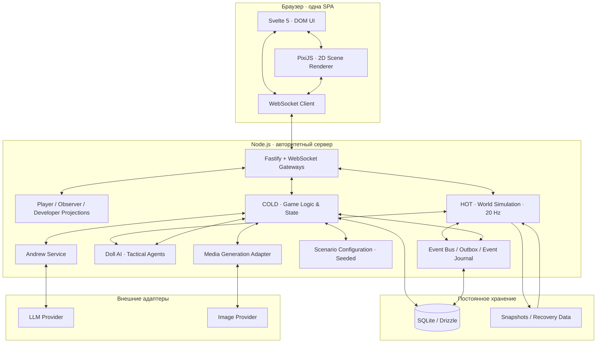

# МНЕМОСИН — SYSTEM_ARCHITECTURE.md

**Целевая архитектура v4 · Draft 0.1**  
**Статус:** рабочая спецификация, основанная на документе «Цикл 48» и последующих согласованных решениях.  
**Дата фиксации:** 2026-11-08  
**Назначение:** описать целевую системную архитектуру игры, границы подсистем, основные потоки данных и принципы безопасности. Документ не утверждает, что перечисленные компоненты уже реализованы.

---

## 0. Статус документа и источники решений

Этот документ описывает **целевую архитектуру v4**, а не текущее состояние ветки `main`.

Источники:

1. Пользовательский документ «ЦИКЛ 48 — игровой документ (сводка решений)», прежде всего разделы 5–18.
2. Последующие согласованные решения:
   - игра работает в браузере;
   - игровой процесс не требует присутствия человеческого GM;
   - GM Review используется только в разработке и тестировании ИИ;
   - наблюдатель («Бог») необязателен, не занимает место игрока и видит всё скрытое игровое состояние;
   - полномочия наблюдателя на вмешательство отделены от полномочий на просмотр;
   - поведение кукол тактическое, а набор возможностей и сложность меняются от этажа к этажу;
   - взаимодействия с окружением ограничены основными типами: переключение света, открытие/закрытие дверей, укрытия;
   - Андрей — гибридный персонаж: сценарные ограничения и состояние задаются игрой, свободные реплики формирует LLM.
3. Текущее содержимое публичного репозитория `Vekktor55/Mnemosin`, проверенное 2026-11-08: [README.md](https://github.com/Vekktor55/Mnemosin/blob/main/README.md) и [docs/ARCHITECTURE.md](https://github.com/Vekktor55/Mnemosin/blob/main/docs/ARCHITECTURE.md).

### 0.1. Как читать статусы решений

- **СОГЛАСОВАНО** — явно зафиксировано в «Цикле 48» или подтверждено пользователем в обсуждении.
- **ПРЕДЛАГАЕТСЯ** — архитектурная рекомендация для дальнейшего проектирования; до отдельного подтверждения не считается окончательным решением.
- **ОТКРЫТО** — требует отдельного обсуждения, эксперимента или измерения.

Если раздел содержит несколько статусов, статус указан непосредственно рядом с решением.

### 0.2. Связь с текущей веткой репозитория

На момент проверки README репозитория описывает этап 1 «Стол» (Table MVP): GM-in-the-loop, Turn Engine, `modules/turn`, отдельный GM UI и AI Director, формирующий черновик разрешения хода. Существующая `docs/ARCHITECTURE.md` также содержит журнал решений этой архитектуры.

Целевая v4 меняет фундаментальную модель исполнения: **Turn Engine удаляется, а непрерывная серверная симуляция становится основой пространственного игрового процесса**. Это не означает, что полезные части текущего кода надо удалить. Перед миграцией необходимо проверить фактические зависимости и сохранить пригодные компоненты: контракты, StateService, LocationService, Journal, Chat, Story, Session, WebSocket transport, EventBus/Outbox, идемпотентность, snapshots, конфигурацию, логирование, тестовую инфраструктуру и архитектурные ограничения.

Новый документ является целевым архитектурным ориентиром. Он не заменяет исторический журнал решений автоматически и не является отчётом о реализации.

---

# 1. Продуктовые и технические цели

## 1.1. Игровой формат

**СОГЛАСОВАНО**

- Жанр: социальная дедукция, выживание и крафт.
- Размер партии: 6–10 игроков.
- Продолжительность партии: ориентировочно 4–5 часов.
- Платформа: браузер.
- Формат клиента: одна SPA.
- Основной режим: наклонная 2D-сцена с перемещением в реальном времени.
- Чат, документы, записки, журналы, инвентарь и прочие интерфейсы отображаются DOM-слоем поверх сцены.
- Игровая сцена и текстовые интерфейсы представляют один игровой мир, но показывают его разными способами.
- Человеческий ведущий не требуется для старта или нормального прохождения партии.
- Наблюдатель («Бог») — необязательная дополнительная роль.

## 1.2. Архитектурные цели

1. Сервер является единственным авторитетным источником игрового состояния.
2. Пространственные действия рассчитываются детерминированной серверной логикой, а не LLM.
3. Непрерывная симуляция не зависит от завершения хода, человеческого подтверждения или ответа внешнего провайдера.
4. Приватность, роли, заражение, достоверность предметов и следы контролируются сервером.
5. LLM применяется только в ограниченных сценариях, где действительно нужна генерация языка.
6. Недоступность LLM или генерации изображений не должна останавливать партию.
7. Система должна поддерживать восстановление партии после отключения клиента и предусматривать восстановление после аварии сервера.
8. Архитектура остаётся модульным монолитом до появления измеримой причины разделять её на сервисы.

## 1.3. Не входит в текущую цель

**СОГЛАСОВАНО**

- Настоящий 3D-игровой мир.
- Unity, Three.js или Babylon.js как основной игровой движок.
- Физика разрушаемого мира и falling-sand-подобная симуляция.
- Непрерывные вызовы LLM на перемещение, каждый триггер или каждый тик.
- Генерация сюжетной статики в рантайме.
- Обязательное участие человеческого GM.
- Прямое PvP-убийство с исключением игрока из партии.

---

# 2. Технологическая основа

| Область                  | Целевая технология / подход                                 | Статус и замечания                                                                             |
| ------------------------ | ----------------------------------------------------------- | ---------------------------------------------------------------------------------------------- |
| Язык сервера             | TypeScript, strict mode, Node.js 22+                        | **СОГЛАСОВАНО**, продолжить текущий стек                                                       |
| HTTP                     | Fastify                                                     | **СОГЛАСОВАНО**, сохранить                                                                     |
| Реальное время           | WebSocket                                                   | **СОГЛАСОВАНО**, сохранить существующий транспорт и развить протокол                           |
| База данных              | SQLite + Drizzle                                            | **СОГЛАСОВАНО** на текущем масштабе; конкретный SQLite-драйвер остаётся реализационной деталью |
| Контракты                | TypeScript + Zod, пакет `shared/contracts`                  | **СОГЛАСОВАНО**, расширять версионируемые схемы                                                |
| Клиентское приложение    | Svelte 5 + Vite, SPA                                        | **СОГЛАСОВАНО**, сохранить                                                                     |
| 2D-рендеринг             | PixiJS                                                      | **СОГЛАСОВАНО как целевой выбор**, отсутствует основание считать его уже внедрённым            |
| Производство графики     | Blender → рендер PNG → единая палитра/пикселизация → PixiJS | **СОГЛАСОВАНО как целевой pipeline**                                                           |
| Тесты                    | Vitest, Playwright, архитектурные и контрактные тесты       | **СОГЛАСОВАНО**, сохранить и расширить                                                         |
| Ограничения зависимостей | Modular Monolith, Ports & Adapters, dependency-cruiser      | **СОГЛАСОВАНО**, сохранить                                                                     |
| LLM                      | Адаптер за портом; конкретный провайдер настраивается       | **СОГЛАСОВАНО концептуально**, провайдер и лимиты открыты                                      |
| Генерация изображений    | Отдельный MEDIA_PROVIDER                                    | **СОГЛАСОВАНО концептуально**, опциональная возможность                                        |

**Примечание по базе:** текущая документация репозитория описывает SQLite/Drizzle и содержит принятое решение использовать libsql-драйвер в существующей реализации. Этот документ не фиксирует замену драйвера. При проектировании новых подсистем следует использовать существующий database adapter и не привязывать доменную логику к конкретному драйверу.

---

# 3. Архитектурная модель верхнего уровня

## 3.1. Главный принцип

**Сервер симулирует мир. Клиент отображает мир. LLM не является источником игровой истины.**

Сервер знает игровые координаты, состояния объектов, роли, ресурсы, факты, следы и правила. Клиент получает только разрешённую проекцию состояния и отображает её в наклонной 2D-сцене.

## 3.2. Контекстная схема

Схема показывает логические границы, а не обязательное количество процессов. На первом этапе это один серверный процесс с внутренними модулями.

## 3.3. Основные слои

1. **Presentation Layer:** браузерная SPA, Svelte UI и PixiJS-сцена.
2. **Transport Layer:** HTTP, WebSocket, аутентификация, валидация входящих сообщений и серверные проекции.
3. **HOT Simulation Layer:** непрерывная пространственная симуляция в памяти.
4. **COLD Game Logic Layer:** дискретные действия, правила партии, владение состоянием и долговременная история.
5. **Actor Layer:** алгоритмическое поведение кукол и других управляемых сущностей.
6. **Intelligence Adapters:** Андрей через LLM и опциональная генерация изображений.
7. **Persistence & Infrastructure:** база данных, event outbox, snapshots, логирование, конфигурация и мониторинг.

---

# 4. Клиент: Svelte + PixiJS

## 4.1. Svelte — интерфейс приложения

Svelte отвечает за DOM-интерфейс:

- чат и социальные каналы;
- инвентарь и экипировку;
- документы, записки, аудиозаписи и журналы;
- терминалы и интерфейсы устройств;
- крафт и проверки;
- голосования и решения на пороге;
- состояние игрока и уведомления;
- интерфейс наблюдателя, если он подключён.

Svelte не рассчитывает авторитетную игровую физику и не принимает окончательные решения о координатах, обнаружении, захвате или подлинности объектов.

## 4.2. PixiJS — визуализация игрового мира

PixiJS отвечает за:

- отрисовку фона комнаты и тайловых пространств;
- отрисовку персонажей, кукол и интерактивных объектов;
- камеру, масштабирование и визуальную интерполяцию движения;
- сортировку объектов по глубине;
- отображение газа, света и визуальных эффектов;
- анимации и визуальную реакцию на серверные события;
- проекцию серверной квадратной сетки в наклонную 2D-сцену.

PixiJS не является источником истинных координат и не решает, может ли персонаж пройти через препятствие.

## 4.3. Производство сцены

**СОГЛАСОВАНО по «Циклу 48», §16:**

- наклонная 2D-подача в индустриальной эстетике;
- графические ресурсы преимущественно создаются в Blender;
- ортографический рендер экспортируется в PNG;
- используется единая ограниченная палитра;
- масштабирование пиксельной графики — nearest/point;
- для атмосферных комнат можно использовать запечённый фон;
- для коридоров и перестраиваемых участков — наклонную тайловую сетку.

### Два способа представления мира

**Baked Room:** единый статичный фон комнаты, поверх которого размещаются динамические сущности и эффекты.

**Tile-based Isometric Area:** тайловая сетка, подходящая для коридоров и зон с динамической перестройкой.

Обе системы обязаны использовать единую серверную систему игровых координат и согласованную клиентскую проекцию.

## 4.4. Освещение

**ПРЕДЛАГАЕТСЯ:** разделить художественное освещение и игровое освещение.

- Базовое художественное освещение может быть запечено в Blender-фон.
- Динамическое освещение, переключаемое игроками или событиями, отображается отдельным клиентским слоем.
- Игровые параметры света (активность, положение, радиус, тип и влияние на обнаружение) хранятся и рассчитываются сервером.
- Сервер не обязан рассчитывать визуально красивые тени. Он рассчитывает только игровые последствия света.

Для baked-комнат нужны отдельные варианты/слои или маски, чтобы выключение света не оставляло визуально неизменный яркий фон. Конкретная техника — маски, слои, tint или несколько подготовленных состояний — **ОТКРЫТА**.

---

# 5. Сервер: HOT / COLD

## 5.1. HOT — непрерывная симуляция

**СОГЛАСОВАНО:** HOT — in-memory симуляция с целевой частотой 20 Гц. Один шаг составляет 50 мс.

HOT отвечает за непрерывные величины и пространственные процессы:

- позиции и движение игроков;
- позиции и движение кукол;
- столкновения и проходимость;
- расчёт расстояний и пространственных зон;
- поле загрязнения воздуха и его воздействие;
- расход активного фильтра;
- пространственное восприятие кукол;
- локальные стимулы: движение, свет, открытая дверь, прикосновение к объекту и т. п.;
- переходы состояний тактических агентов;
- проверку условий обнаружения и захвата;
- подготовку обновлений сцены.

### Правила HOT

1. HOT не вызывает LLM.
2. HOT не ожидает человека и не выполняет GM Review.
3. HOT не обращается к Drizzle/SQLite на каждом тике.
4. HOT не принимает координаты клиента как доверенные.
5. HOT не отправляет клиенту скрытые роли и флаг заражения.
6. HOT не выполняет тяжёлые действия, не требующие частого обновления, на каждом тике.
7. HOT публикует дискретные события при пересечении условий/порогов, а не бесконечный поток одинаковых фактов.

### Бюджет тика

Целевой период — 50 мс. Это бюджет всего шага, а не разрешённое время одной подсистемы.

**ПРЕДЛАГАЕТСЯ:**

- использовать фиксированный шаг симуляции;
- ограничить/измерять длительность каждого блока симуляции;
- выносить поиск пути, редкие проверки и обновление стратегических решений из полного цикла, запускать их по событиям или расписанию;
- при перегрузке не запускать неконтролируемое количество catch-up тиков;
- собирать метрики tick duration, tick overrun, queue depth и числа активных сущностей.

Достаточность 20 Гц для реального ощущения движения должна быть подтверждена прототипом и нагрузочным тестом.

## 5.2. COLD — дискретная игровая логика

COLD отвечает за изменения, которые имеют самостоятельное игровое значение и должны быть зафиксированы:

- роли, команда и скрытая принадлежность;
- инвентарь и владение предметами;
- экипировка и передача предметов;
- состояния партии, этажей и фаз;
- крафт и результаты крафта;
- качество и подлинность компонентов;
- заражение и лечение;
- документы, улики и следы;
- сообщения, записки и социальные действия;
- результаты проверок и взаимодействий;
- захват и освобождение игрока;
- история событий и действий;
- условия концовок.

COLD работает событийно, через команды и обработчики событий. В игре нет Turn Engine и нет обязательной границы хода.

### StateService

**СОГЛАСОВАНО:** существующий `StateService` сохраняется как единый контролируемый путь изменения долговременного игрового состояния.

Его нельзя обходить прямой записью из модулей, transport gateway или клиента.

**ПРЕДЛАГАЕТСЯ:** отвязать использование StateService от turn-boundary. Дискретные команды и события должны проходить через него независимо от того, на каком этапе пространственной симуляции они возникли.

StateService не вызывается на каждом HOT-тике.

## 5.3. Граница HOT / COLD

Главный критерий:

- **HOT:** координаты, время, расстояние, скорость, радиус, текущая непрерывная величина.
- **COLD:** владение, подтверждённое действие, игровое последствие, роль, факт, улика, история.

### Владение состоянием по примерам

| Данные                                 | Владелец истины             | Участие другого слоя                                                                   |
| -------------------------------------- | --------------------------- | -------------------------------------------------------------------------------------- |
| Координаты и скорость игрока           | HOT                         | COLD получает значимые события/снимки, если требуется история                          |
| Координаты и режим движения куклы      | HOT                         | COLD хранит важные последствия и конфигурацию                                          |
| Предмет в инвентаре                    | COLD                        | HOT получает необходимые сведения для симуляции                                        |
| Остаток активного фильтра              | HOT                         | COLD фиксирует расход/истощение как значимое событие                                   |
| Запас неиспользованных фильтров        | COLD                        | HOT получает runtime-представление экипировки                                          |
| Каноническое состояние двери           | COLD                        | HOT применяет его к коллизиям и навигации                                              |
| Каноническое состояние света           | COLD                        | HOT учитывает игровое влияние на обнаружение                                           |
| Динамическая позиция источника/объекта | HOT, если объект движется   | COLD хранит устойчивое состояние и важные события                                      |
| Состояние укрытия и занятость          | COLD для факта входа/выхода | HOT учитывает скрытие и ограничения перемещения/обнаружения                            |
| Истинная роль/заражение                | COLD                        | HOT получает только минимально необходимый внутренний сигнал, клиентам не раскрывается |
| История контактов и доказательства     | COLD                        | HOT создаёт исходные пространственные события                                          |

Таблица задаёт целевой принцип владения. Точные контракты объектов и runtime-представлений оформляются отдельно.

## 5.4. Межслойное взаимодействие

### HOT → COLD

HOT публикует дискретные события, например:

- `player.caught`;
- `filter.depleted`;
- `player.entered_proximity`;
- `player.left_proximity`;
- `doll.detected_target`;
- `object.triggered`;
- `gas.threshold_crossed`.

Событие должно содержать уникальный `eventId`, тип, идентификаторы сущностей, игровое время/tick и минимальный контекст, достаточный для обработки.

Обработчики COLD обязаны быть идемпотентными: повторная доставка одного события не должна повторно захватывать игрока, списывать ресурс или создавать дублирующую улику.

### COLD → HOT

COLD передаёт HOT команды и изменения runtime-проекции:

- открыть/закрыть дверь;
- включить/выключить источник света;
- создать/удалить runtime-объект;
- установить экипированный фильтр;
- изменить параметры газа;
- перевести игрока в состояние укрытия;
- изменить параметры куклы или профиля этажа.

Изменения, влияющие на симуляцию, применяются на границе тика, чтобы один шаг не видел частично обновлённое состояние.

### Надёжность границы

Текущая инфраструктура уже содержит EventBus/Outbox и доставку событий с at-least-once семантикой для долговременных событий. Это полезная основа COLD.

**ОТКРЫТО и обязательно к проектированию:** гарантия доставки события, созданного в in-memory HOT, при аварийном падении сервера до его фиксации в COLD. Нужно выбрать и протестировать механизм очереди/подтверждения/снимка, не добавляя синхронную запись в базу на каждый тик.

До решения этого вопроса нельзя обещать полное восстановление любого события HOT после аварии.

---

# 6. Пространственная модель мира

## 6.1. Система координат

**СОГЛАСОВАНО по «Циклу 48», §16:** сервер использует обычную квадратную сетку `(gx, gy)`. Наклонная проекция существует только на клиенте.

Серверная игровая логика не знает о визуальном наклоне, угле камеры, пиксельных размерах тайла или Blender-камере.

Клиент преобразует координаты сетки в экранные координаты функцией проекции и применяет визуальную сортировку.

## 6.2. Геометрия

Серверу нужна игровая геометрия, не зависящая от PNG:

- проходимость клеток;
- границы и препятствия;
- проёмы и двери;
- блокировка обзора;
- интерактивные зоны;
- укрытия;
- waypoints патрулей;
- зоны триггеров;
- статические и динамические источники света.

**ПРЕДЛАГАЕТСЯ:** хранить такие данные в versioned world-pack, отдельно от художественных ресурсов. PNG не является источником данных для collision, navigation или line-of-sight.

## 6.3. Навигация

**ОТКРЫТО:** алгоритм навигации и формат навигационных данных.

**ПРЕДЛАГАЕТСЯ для первого прототипа:** A* по квадратной сетке с поддержкой динамической проходимости дверей. Это рекомендация, а не уже утверждённое решение.

Маршрут пересчитывается по событию изменения цели или доступности пути, а не автоматически на каждом 20 Гц тике.

## 6.4. Газ

Поле загрязнения воздуха — пространственные данные мира. HOT рассчитывает игровое воздействие газа и расход активного фильтра.

**ОТКРЫТО:** способ представления поля — постоянные зоны/значения по клеткам, компактная сетка концентраций или иная модель. Выбор должен учитывать, что игра не использует falling-sand и не симулирует движение каждой частицы газа.

## 6.5. Свет и обнаружение

Клиент отображает свет. Сервер рассчитывает игровые последствия света.

**ОТКРЫТО:** точная модель видимости: конус обзора, line-of-sight по блокирующим клеткам, уровни освещённости, типы источников и правила обнаружения в полной темноте.

Необходимо обеспечить согласованность: клиент не должен показывать визуально очевидную безопасную темноту, если сервер считает персонажа обнаруживаемым, и наоборот.

## 6.6. Звук и локальные стимулы

Глобальной публичной шкалы шума нет. Куклы реагируют на локальные стимулы.

Сервер создаёт стимулы с координатой, типом и параметрами интенсивности/дальности. Каждый агент получает только те стимулы, которые попадают в область его восприятия и соответствуют его чувствительности.

**ОТКРЫТО:** будет ли акустика моделироваться геометрически (стены/двери ослабляют сигнал) или на первом этапе будет использоваться упрощённый радиус с коэффициентами ослабления.

---

# 7. Игровые взаимодействия с окружением

**СОГЛАСОВАНО:** физически интерактивный мир на первом этапе ограничен базовыми действиями:

1. включение и выключение света;
2. открытие и закрытие дверей;
3. вход в укрытие и выход из него.

Это не отменяет предметные и социальные игровые действия из концепции: подбор предметов, взаимодействие с терминалами, крафт, чтение документов, передача ресурсов и разговоры остаются COLD-действиями с собственными правилами.

## 7.1. Единый Interaction System

**ПРЕДЛАГАЕТСЯ:** единый серверный механизм команд взаимодействия с объектами.

Каждая команда проходит проверки:

- игрок аутентифицирован и участвует в сессии;
- целевой объект существует и доступен в текущем world-pack;
- игрок находится в разрешённой дистанции;
- объект допускает запрошенное действие;
- состояние объекта позволяет выполнить действие;
- действие разрешено фазой/правилами/состоянием игрока;
- команда не является повтором уже обработанного запроса.

Сервер получает `playerId` из авторизованного контекста, а не доверяет идентификатору из payload.

## 7.2. Двери

Дверь имеет каноническое состояние и набор свойств: открыта/закрыта, заперта/разблокирована, блокирует ли движение и обзор. Открытие или закрытие фиксируется как дискретная команда COLD; HOT получает обновление проходимости на границе тика.

## 7.3. Свет

Переключение света — дискретная команда COLD. HOT использует изменившееся runtime-состояние для расчёта обнаружения. Клиент обновляет динамический визуальный слой.

## 7.4. Укрытия

Вход/выход из укрытия — дискретное действие. Состояние занятости должно быть единым и серверным. Укрытие не означает безусловную невидимость: куклы могут обнаружить вход, проверить объект или получить иной локальный стимул в соответствии с правилами.

**ОТКРЫТО:** вместимость укрытий, допустимость совместного укрытия, защита от разных способов обнаружения и последствия обнаружения.

---

# 8. Тактический ИИ кукол

## 8.1. Общий принцип

**СОГЛАСОВАНО:** куклы управляются алгоритмической поведенческой системой, не LLM. Сложность и доступные тактические возможности меняются от этажа к этажу.

Единый Doll AI Engine обслуживает разные типы кукол. Разновидности кукол и этажи задают параметры, допустимые состояния и набор поведенческих возможностей.

## 8.2. Логические компоненты агента

**ПРЕДЛАГАЕТСЯ:** разделить агента на четыре части:

1. **Perception** — получение доступных локальных стимулов: движение, свет, открытая дверь, взаимодействия с объектами и присутствие Мнемосина.
2. **Decision** — выбор следующего поведения на основе текущего состояния, памяти агента и его профиля.
3. **Navigation** — построение и выполнение маршрута по серверной геометрии.
4. **Action** — движение, обследование, охрана, блокирование прохода, преследование, захват и другие разрешённые действия.

Для первой реализации предлагается конечная машина состояний (FSM) и ограниченный набор правил принятия решений. Behavior Tree, Utility AI и сложная планирующая система не вводятся заранее без необходимости, подтверждённой прототипом.

## 8.3. Тактические профили этажей

Floor Tactical Profile конфигурирует поведение на текущем этаже. Возможные группы параметров:

- чувствительность к разным стимулам;
- дальность восприятия;
- длительность памяти о цели/сигнале;
- доступные поведения;
- способность передавать информацию другим куклам;
- уровень координации;
- частота перепланирования;
- ограничения конкретного типа куклы.

Увеличение сложности не должно сводиться только к ускорению кукол или увеличению радиуса обнаружения. По мере спуска могут открываться новые способы координации и тактические действия.

**ОТКРЫТО:** точные профили Э1–Э6, каталог поведений, правила координации и то, кто именно может обмениваться информацией.

## 8.4. Ограниченное знание кукол

Агент не должен знать позиции всех игроков автоматически. Он оперирует собственными наблюдениями и теми сведениями, которые получил разрешённым механизмом координации.

**ПРЕДЛАГАЕТСЯ:** использовать локальную память наблюдений с временем истечения и уровнем уверенности. Общая тактическая память команды кукол (blackboard или другой механизм) остаётся вариантом реализации, а не принятым решением.

## 8.5. Типы кукол

Типы из «Цикла 48» сохраняются как контентная классификация:

- обычные — патруль/ловушки;
- большие — «Мать», «Отец», «Врач», «Смотритель», в том числе перенос захваченных в Детскую;
- пустышки — приманки;
- швы — визуальные/средовые проявления без обязательного создания нового полноценного агента.

Не каждый тип обязан иметь отдельный программный класс. Предпочтительна общая система возможностей и конфигураций, если это не усложняет поведение.

## 8.6. Захват

Куклы не убивают игрока и не удаляют его из партии. Захват переводит игрока в состояние `Captured`/«Захваченный» и связан с Детской/Стазисом по правилам игры.

HOT определяет физическое условие захвата. COLD фиксирует игровое последствие, состояние игрока и историю события.

---

# 9. Конфигурация сценария и реиграбельность

## 9.1. Scenario Configuration

**СОГЛАСОВАНО:** начальная конфигурация партии формируется алгоритмически с использованием seed, без обращения к LLM.

Конфигурация может включать:

- распределение ролей;
- выбранную пару подменённых якорей/персонажей согласно правилам сценария;
- список бракованных или подменённых предметов;
- варианты поведения кукол;
- параметры тактического профиля;
- допустимый набор вариантов инцидентов;
- другие заранее описанные переключатели партии.

## 9.2. Валидация конфигурации

**ПРЕДЛАГАЕТСЯ:** после генерации конфигурация проходит проверку непротиворечивости и условий проходимости:

- критически необходимые предметы и станции достижимы;
- нет комбинации состояний, заранее блокирующей все варианты прохождения;
- распределение ролей соответствует допустимому количеству игроков;
- обязательные сюжетные условия не конфликтуют с настройками партии;
- комбинация инцидентов не создаёт недопустимое состояние.

Точный набор инвариантов и допустимых сценарных комбинаций оформляется отдельной спецификацией.

## 9.3. Реиграбельность

История и статические тексты остаются фиксированными и авторскими. Вариативность формируется через:

- решения и поведение игроков;
- распределение ролей и состояния партии;
- выбор seed-конфигурации;
- варианты бракованных предметов;
- маршруты и тактические решения кукол;
- взаимодействие с Андреем и переданные ему ложные сведения.

LLM не генерирует обязательные улики, факты или сюжетные развилки в рантайме.

---

# 10. LLM и AI-инфраструктура

## 10.1. Общее правило

LLM не участвует в HOT и не является источником канонического игрового состояния.

Если задача решается проверяемым алгоритмом, она не должна отправляться в LLM.

## 10.2. Андрей — Voice

**СОГЛАСОВАНО:** Андрей — единственный обязательный в концепции интерактивный LLM-персонаж. Он сочетает сценарные ограничения и генерируемые реплики.

Сценарная система хранит:

- объективные факты мира;
- знания, доступные Андрею;
- убеждения Андрея и их источники;
- уровень доверия к отдельным игрокам;
- историю разговоров;
- состояние комнаты и канала связи;
- ограничения поведения и сюжетную арку.

Важно разделять **истинные факты** и **убеждения Андрея**. Игрок может сообщить Андрею ложь; Андрей может поверить в неё и передать её другим. Это игровая механика, а не право LLM менять канон.

LLM формирует реплику в рамках переданного контекста. Она не может непосредственно:

- менять роли или заражение;
- менять подлинность предметов;
- создавать или удалять канонические факты;
- открывать недоступные сюжетные сведения;
- менять геометрию мира;
- управлять куклами в HOT.

Предложенные моделью изменения памяти/убеждений должны проходить структурную проверку и применяться отдельной серверной логикой. Источник и уверенность убеждения должны сохраняться.

## 10.3. GM Review в разработке

GM Review существует как инструмент тестирования и контроля качества работы Андрея во время разработки.

В обычной игровой партии:

- нет обязательного человека, подтверждающего реплики;
- запрос не ждёт GM;
- ответ проходит автоматическую валидацию;
- при недоступности провайдера применяется fallback.

Developer Mode может позволять сравнить исходный ответ модели, контекст запроса, автоматическую проверку и выбранный fallback. Эти данные не становятся автоматически видимыми обычным игрокам или наблюдателю, если отдельно не предусмотрено его право на диагностику.

## 10.4. LLM Gateway

**ПРЕДЛАГАЕТСЯ:** все обращения к LLM проходят через единый адаптерный слой:

- Provider Adapter;
- Request Queue;
- Token/Request Budget Manager;
- Timeout и ограниченные Retry;
- Response Validator;
- Cache, если запрос допускает безопасное кэширование;
- метрики и журнал вызовов;
- fallback.

Ни один игровой модуль не должен импортировать SDK конкретного провайдера напрямую.

Конкретные лимиты токенов, число запросов на партию, максимальная длина ответа и политика повторов **ОТКРЫТЫ** до выбора провайдера и измерения реального расхода.

## 10.5. Глаза — генерация изображений

Генерация изображений — отдельная опциональная возможность с собственным `MEDIA_PROVIDER`.

Изображение является иллюстрацией, а не игровым фактом. Имена, предметы, канонические сведения и результаты дедукции хранятся в текстовых/структурированных данных и не выводятся из сгенерированной картинки.

Нужны ограничения размера запроса, кэширование одинаковых запросов и fallback при недоступности провайдера.

## 10.6. Статика

Записки, аудио, описания комнат, документы и варианты искажённых улик заранее написаны автором и загружаются как данные.

Для улик могут существовать заранее подготовленные версии `content_true` и `content_distorted`. Сервер выбирает нужную версию по правилам и проекции игрока. LLM не переписывает статические улики в рантайме.

---

# 11. Наблюдатель («Бог») и Developer Mode

## 11.1. Роль наблюдателя

**СОГЛАСОВАНО:** наблюдатель необязателен и не занимает слот игрока. Он может подключиться к партии для наблюдения и ограниченного вмешательства.

## 11.2. Полная видимость

**СОГЛАСОВАНО:** наблюдатель имеет omniscient read access ко всему скрытому **игровому** состоянию партии, в том числе:

- истинные роли и заражение;
- скрытое состояние игроков;
- истинную подлинность и качество предметов;
- испорченные компоненты, устройства и шприцы;
- приватные сообщения и историю контактов;
- скрытые события и тайные цели;
- фактическое положение всех игроков и кукол;
- внутреннее состояние и доступные убеждения Андрея;
- сценарную конфигурацию и seed;
- состояние этажей, дверей, света, газа, укрытий и станций;
- журнал значимых действий и вмешательств.

Это **не означает** доступ к секретам инфраструктуры: API-ключам, паролям, приватным ключам, переменным окружения или секретам провайдеров.

Наблюдатель видит фактическую память/убеждения Андрея, сохранённые системой, но не получает несуществующее «скрытое рассуждение» модели.

## 11.3. Полномочия на вмешательство

Полная видимость не означает автоматически неограниченное управление.

**СОГЛАСОВАНО:** права просмотра и вмешательства разделены.

**ПРЕДЛАГАЕТСЯ:** вмешательство предоставляется через отдельный набор серверных команд с capability-based permissions. Примеры возможных команд:

- включить/выключить конкретный источник света;
- открыть/закрыть допустимую дверь;
- активировать заранее определённый сценарный инцидент;
- изменить разрешённый параметр объекта или куклы;
- переключить наблюдаемую сущность/область.

Точный каталог команд и пределы полномочий **ОТКРЫТЫ**.

Каждое вмешательство:

1. проходит серверную проверку полномочий;
2. выполняется как обычная контролируемая команда;
3. имеет actor=`observer` и свой `commandId`;
4. попадает в неизменяемую историю/аудит;
5. не меняет историю задним числом и не обходит StateService.

Можно отдельно предусмотреть режим наблюдателя без права вмешательства.

## 11.4. Observer Projection

Сервер формирует отдельную полную проекцию для наблюдателя. Нельзя строить её на клиенте из набора PlayerProjection.

Игроки никогда не должны получать ObserverProjection или скрытые поля через общие сообщения сцены.

## 11.5. Developer Mode

Developer Mode предназначен для разработки, тестирования и диагностики. Он может включать:

- просмотр сырых диагностических событий;
- анализ tick timing и очередей;
- просмотр запросов/ответов AI provider;
- повтор воспроизводимой конфигурации партии по seed;
- тестовые команды и инъекцию контролируемых событий;
- проверку приватности и корректности проекций.

Developer Mode не является игровой ролью и не должен включаться обычным пользовательским правом наблюдателя.

---

# 12. Сетевая модель и приватность

## 12.1. Авторитетность сервера

Клиент отправляет **намерения и команды**, а не окончательные координаты или результаты взаимодействий.

Для движения клиент может отправлять направление/вектор ввода или другую ограниченную команду движения. Сервер:

- проверяет скорость и допустимый режим движения;
- рассчитывает достижимую позицию от последней авторитетной позиции;
- учитывает сетку, препятствия и состояние игрока;
- отклоняет или ограничивает недопустимый ввод;
- публикует авторитетное обновление сцены.

Прямое принятие клиентской позиции без проверки запрещено.

## 12.2. Частоты

**СОГЛАСОВАНО:** симуляция — 20 Гц.

Клиент может отрисовывать сцену с частотой экрана и интерполировать между серверными обновлениями. Серверный tick и частота визуального кадра — разные величины.

**ПРЕДЛАГАЕТСЯ:** начать с синхронизации состояния сцены с частотой, согласованной с 20 Гц симуляции, затем оптимизировать её на измерениях. Большие статические данные карты не передаются каждый тик.

Канал обновлений сцены (`scene:tick` или эквивалент) отделяется от повествовательных и приватных сообщений. Сводка контактов и матрица приватности не должны пересчитываться на частоте клиентского рендеринга.

## 12.3. Типы сообщений

Названия ниже следуют предложению из «Цикла 48» и не являются утверждённым окончательным WS-контрактом:

- `scene:input` — клиент → сервер, намерение движения/ввода;
- `scene:tick` — сервер → клиент, обновление авторитетной сцены;
- `scene:trigger` — результат/сигнал пространственного триггера;
- `scene:caught` — событие захвата в разрешённой проекции;
- `trace:record` — запись следа с соблюдением приватности;
- `gas:update` — обновление сведений о газе;
- interaction command/result — команды включения света, дверей, укрытий и иных разрешённых объектов.

Все payload-схемы определяются в `shared/contracts` и валидируются на сервере.

## 12.4. Проекции и приватность

Минимум три независимые серверные проекции:

- `PlayerProjection` — разрешённые данные конкретного игрока;
- `ObserverProjection` — всё скрытое игровое состояние;
- `DeveloperProjection` — диагностические данные для разработчика.

Скрытый флаг заражения никогда не отправляется обычному клиенту игрока.

Приватные каналы вычисляются сервером. Базовое правило из «Цикла 48»: канал доступен, если дистанция ниже порога и обе стороны находятся в одной локации. Результат может кэшироваться и обновляться при изменении позиции/состояния, а не пересчитываться на частоте 60–120 FPS.

**ОТКРЫТО:** точная семантика шёпота — слышат ли весь текст все игроки в радиусе или только адресат; виден ли окружающим визуальный факт приватного обмена; какие следы создают аудио/диктофон/радиостанция. Эти вопросы решаются игровым дизайном и фиксируются в матрице приватности.

## 12.5. Reconnect и resync

После переподключения клиент не должен самостоятельно восстанавливать истину из локального кэша.

Сервер повторно выдаёт актуальную проекцию и базовое состояние сцены для конкретной роли. После resync клиент продолжает интерполяцию с нового авторитетного состояния.

---

# 13. Долговременное хранение, журнал и восстановление

## 13.1. Данные COLD

В постоянном хранилище должны находиться:

- состояние сессии и партии;
- роли и скрытые игровые факты;
- предметы и их владельцы;
- состояния станций, устройств и дверей;
- крафт и качество результатов;
- доказательства и журнал событий;
- диалоги/убеждения Андрея в нужном объёме;
- конфигурация партии и seed;
- команды и действия наблюдателя;
- снимки состояния.

Точная нормализация таблиц и JSON-представления — задача схемы данных, отдельной от этого документа.

## 13.2. HOT snapshots

HOT работает в памяти и не пишет каждое изменение координат в БД.

**ПРЕДЛАГАЕТСЯ:** периодически сохранять контрольный снимок runtime-состояния, достаточный для восстановления:

- текущих координат/состояний движения;
- позиций и состояний кукол;
- их текущих целей/маршрутов, если эти данные необходимы для продолжения;
- активных временных эффектов и таймеров;
- состояния runtime-поля газа;
- активной экипировки и остатка фильтров;
- версии world-pack и тактического профиля.

Снимок должен быть согласован с версией COLD-состояния и игровым временем.

## 13.3. Восстановление

После аварии сервер загружает согласованный snapshot, сверяет его с COLD-state и продолжает симуляцию.

**ОТКРЫТО:** требуется определить частоту snapshots, формат tick clock, хранение pending HOT events и правила replay. До выбора этих механизмов нельзя обещать точное воспроизведение каждого промежуточного тика.

При штатном отключении сервера должен выполняться graceful shutdown: остановить приём новых команд, завершить/зафиксировать допустимую очередь событий, сохранить согласованный снимок и корректно закрыть транспорт и БД.

---

# 14. Игровые фазы и игровой цикл

Партия не делится на сериализованные ходы. Фазы — это высокоуровневое состояние партии и набор доступных правил, но не остановка симуляции.

На каждом этаже предусмотрен цикл:

1. Вход и оценка воздуха.
2. Исследование.
3. Инцидент.
4. Разбор.
5. Порог.

Фазы управляются COLD как состояниями сценария/этажа. HOT продолжает работать в соответствии с правилами текущей фазы, в том числе во время обсуждения и принятия решений.

Переходы между этажами и решения о том, кто остаётся наверху, фиксируются как дискретные команды COLD и приводят к обновлению активной пространственной конфигурации.

---

# 15. Безопасность и доверие

1. Сервер проверяет каждый ввод и каждое взаимодействие.
2. Идентификатор игрока берётся из авторизованной сессии.
3. Клиент не является источником истины для координат, инвентаря, заражения или подлинности предмета.
4. PlayerProjection исключает скрытые роли и недоступную игроку информацию.
5. ObserverProjection доступна только аутентифицированной роли наблюдателя.
6. DeveloperProjection доступна только защищённому developer/admin-контексту.
7. Вмешательства наблюдателя журналируются.
8. Ответы LLM валидируются и не могут напрямую менять канонический GameState.
9. Внешние провайдеры не получают больше игрового контекста, чем необходимо для конкретного запроса.
10. Логи не должны случайно раскрывать приватный текст игроков или секретные поля. Маскирование логов сохраняется и расширяется по мере появления новых типов данных.

---

# 16. Отказоустойчивость и деградация

Игра должна оставаться проходимой при отказе необязательных внешних компонентов.

| Отказ                             | Ожидаемое поведение                                                                                                                                 |
| --------------------------------- | --------------------------------------------------------------------------------------------------------------------------------------------------- |
| LLM-провайдер недоступен          | Андрей использует fallback/заранее подготовленную реплику или сообщает, что не может ответить; HOT не блокируется                                   |
| LLM отвечает слишком долго        | Запрос завершается по timeout; партия продолжается                                                                                                  |
| Генерация изображения недоступна  | Показывается текст/стандартная иллюстрация; игровые факты не меняются                                                                               |
| Игрок теряет соединение           | Сервер продолжает авторитетную симуляцию по правилам disconnect; после reconnect выдаётся свежая проекция                                           |
| Наблюдатель отключается           | Партия продолжается без него                                                                                                                        |
| Ошибка одного обработчика события | Ошибка изолируется, событие повторяется/помечается по правилам EventBus/Outbox                                                                      |
| Сервер аварийно завершается       | Восстановление из согласованного snapshot и долговременного состояния; точная гарантия зависит от ещё не утверждённой политики HOT event durability |

**ОТКРЫТО:** поведение игрового персонажа при длительном disconnect (оставить на месте, режим AFK, автоматическое укрытие или иное правило) и возможность паузы партии.

---

# 17. Логические модули и границы зависимостей

Ниже — целевая логическая декомпозиция. Она не требует немедленно создавать все каталоги с такими именами.

## 17.1. Server modules

- `session` — создание/вступление/завершение сессии, присутствие и участники.
- `scene` / `simulation` — HOT tick loop, runtime world state, движение и пространственные проверки.
- `spatial` — сетка, расстояния, collision, zones, line-of-sight abstraction.
- `navigation` — геометрия проходимости и поиск маршрутов.
- `dolls` — агенты, восприятие, поведение, маршруты и координация.
- `interactions` — свет, двери, укрытия и единые правила взаимодействия.
- `resources` — газ, фильтры и другие расходуемые ресурсы.
- `inventory` — владение и передача предметов.
- `crafting` — станции, рецепты, компоненты и результаты.
- `evidence` — следы, происхождение фактов, подлинность и проверки.
- `social` — чат, шёпот, приватные сообщения, записки и контактные связи.
- `story` — авторский контент и сюжетные состояния.
- `andrey` — память, убеждения, диалоги и управление LLM-запросами.
- `scenario` — seeded configuration и валидация комбинации условий.
- `observer` — полная проекция и команды наблюдателя.
- `media` — опциональная генерация изображений.

## 17.2. Infrastructure

- database/repositories;
- event bus/outbox;
- HOT/COLD bridge;
- snapshots/recovery;
- WebSocket and HTTP gateways;
- authentication and permissions;
- AI provider adapters;
- media provider adapters;
- logging, metrics and tracing;
- scheduler/jobs.

## 17.3. Направление зависимостей

Сохраняется существующая идея Modular Monolith и Ports & Adapters:

- контракты — leaf-пакет;
- core объявляет доменные порты и общие механизмы;
- модули зависят от контрактов и портов core, но не импортируют друг друга напрямую;
- инфраструктура реализует порты;
- composition root в `apps/server` связывает реализации;
- gateways преобразуют внешние сообщения в команды/запросы модулей;
- клиент зависит от контрактов и клиентской UI/renderer-инфраструктуры, но не от серверной бизнес-логики.

Точные правила dependency-cruiser и arch tests должны быть обновлены вместе с удалением Turn Engine и появлением Simulation Layer.

---

# 18. Нефункциональные требования

## 18.1. Производительность

- HOT target: 20 симуляционных тиков в секунду.
- Tick budget: 50 мс на полный цикл; фактическое распределение бюджета определяется профилированием.
- Никаких сетевых вызовов к LLM, HTTP-провайдерам или синхронной записи в SQLite на tick path.
- Клиентская сцена интерполирует движение и не требует серверной частоты 60/120 Гц.
- Частота рассылки и объём scene snapshots должны проверяться на 6–10 игроках и реальном количестве кукол/объектов.

## 18.2. Детерминизм и воспроизводимость

- Seed сохраняется для каждой партии.
- Конфигурация партии и случайные выборы должны быть воспроизводимы.
- Важные решения алгоритмов должны записываться в диагностические события.
- Для HOT необходимо определить единый источник игрового времени и порядок обработки входящих команд в рамках tick.
- Полная битовая детерминированность всей симуляции пока не является обещанным требованием; её необходимость и стоимость следует оценить отдельно.

## 18.3. Наблюдаемость

Минимальные метрики:

- tick duration / overrun;
- число активных игроков, кукол и объектов;
- размер очередей HOT→COLD и COLD→HOT;
- задержка доставки событий;
- число повторных обработок и ошибок;
- частота и размер snapshots;
- WebSocket latency/reconnect;
- LLM requests, tokens, latency, timeout, fallback и provider errors;
- количество вмешательств наблюдателя.

---

# 19. Миграция от текущей архитектуры

Миграция должна проходить постепенно. Нельзя одновременно переписывать игровой сервер, протокол, клиент и persistence без промежуточных проверяемых этапов.

## Этап 0. Инвентаризация текущей реализации

- сверить код, contracts, tests и документацию;
- определить все зависимости от Turn Engine и `TURN_*` сообщений;
- составить список сохраняемых модулей и функций;
- зафиксировать baseline тестов и архитектурных ограничений.

## Этап 1. Архитектурные контракты

- определить server-side Position/Grid schemas;
- определить команды движения и взаимодействий;
- определить scene snapshot/event schemas;
- определить Player/Observer/Developer projection contracts;
- определить HOT event envelope и идемпотентность;
- обновить WS catalog и privacy matrix.

## Этап 2. Минимальный HOT Simulation

Один тестовый участок, два игрока, серверная сетка, движение, препятствия, авторитетная позиция, scene updates и reconnect/resync.

## Этап 3. HOT/COLD bridge

Добавить входящие команды COLD→HOT и дискретные события HOT→COLD. Проверить идемпотентность, конкуренцию и поведение при отказе обработчиков.

## Этап 4. Пространственные механики

Добавить близость, шёпот, локальные триггеры, свет и двери. Реализовать единую геометрию серверной логики и клиентской проекции.

## Этап 5. Doll AI

Сначала один тип куклы, waypoint-патруль, локальное восприятие, проверка обнаружения, преследование и захват. Затем расширять тактические профили по этажам.

## Этап 6. Клиентская сцена

PixiJS renderer, карта, камера, изометрическая проекция, baked room, tile-based area, сортировка сущностей, динамический свет и visual interpolation.

## Этап 7. Системы партии и Observer

Подключить роли, инвентарь, ресурсы, крафт, доказательства, фазовые правила, концовки, полную ObserverProjection и журналирование God actions.

## Этап 8. Андрей и AI adapters

Добавить LLM Gateway, память/убеждения Андрея, лимиты, fallback, Developer Review и опциональный MEDIA_PROVIDER.

Параллелизация отдельных этапов допустима, если интерфейсы и контракты согласованы.

---

# 20. Открытые архитектурные вопросы

Ниже перечислены вопросы, которые не следует считать решёнными этим документом.

| ID   | Вопрос                                                                                                         | Почему важен                                                                                    |
| ---- | -------------------------------------------------------------------------------------------------------------- | ----------------------------------------------------------------------------------------------- |
| O-01 | Как обеспечивается долговечность HOT-событий при падении сервера до фиксации в COLD?                           | Риск потери захвата/расхода фильтра/следа                                                       |
| O-02 | Как часто и в каком формате сохраняются HOT snapshots?                                                         | Время восстановления и потеря состояния                                                         |
| O-03 | Какой алгоритм и формат навигации использовать?                                                                | Проходимость игроков и кукол                                                                    |
| O-04 | Как моделировать газ: зоны, значения по клеткам или упрощённая сетка?                                          | Производительность и дизайн ресурсов                                                            |
| O-05 | Как сервер определяет видимость и влияние света?                                                               | Согласованность игровой и визуальной информации                                                 |
| O-06 | Как моделировать слышимость: радиус или ослабление стенами/дверями?                                            | Тактика кукол и приватность разговоров                                                          |
| O-07 | Как куклы координируются и какой информацией делятся?                                                          | Сложность tactical AI по этажам                                                                 |
| O-08 | Каковы точные профили кукол Э1–Э6?                                                                             | Баланс и темп эскалации                                                                         |
| O-09 | Какова точная семантика шёпота и видимого факта приватного контакта?                                           | Приватность и доказательства                                                                    |
| O-10 | Каковы вместимость и свойства укрытий?                                                                         | Баланс пряток и обнаружения                                                                     |
| O-11 | Какие именно вмешательства доступны наблюдателю?                                                               | Безопасность и влияние на честность партии                                                      |
| O-12 | Может ли наблюдатель вмешиваться скрытно или все вмешательства должны быть видимы/доказуемы?                   | Доверие к результату партии и аудит                                                             |
| O-13 | Как игрок ведёт себя при длительном отключении клиента?                                                        | Защита от несправедливого захвата и AFK                                                         |
| O-14 | Сколько одновременных партий должен поддерживать один сервер?                                                  | Текущий README фиксирует одну активную сессию на сервер; целевая масштабируемость не определена |
| O-15 | Каков реальный token/request budget Андрея и какой LLM provider используется?                                  | Стоимость, rate limits и доступность                                                            |
| O-16 | Какой способ динамического света использовать поверх baked backgrounds?                                        | Арт-пайплайн и производительность клиента                                                       |
| O-17 | Нужно ли обеспечивать детерминированный replay всей HOT-симуляции или достаточно snapshots + значимых событий? | Сложность восстановления и отладки                                                              |
| O-18 | Какой набор действий и диагностических данных доступен Observer vs Developer?                                  | Разделение игровых и технических полномочий                                                     |

---

# 21. Зафиксированные архитектурные инварианты

Следующие правила считаются обязательными для всех последующих проектных решений:

1. Нет Turn Engine и сериализации игрового мира по ходам.
2. HOT работает независимо от LLM и человека.
3. HOT не обращается к базе данных на каждом тике.
4. Сервер — единственный источник истины координат и игровых последствий.
5. Клиент отправляет намерения, а не авторитетные координаты.
6. Скрытые роли и заражение не отправляются PlayerProjection.
7. Наблюдатель видит все скрытые игровые факты, но его право вмешательства — отдельная permission.
8. Вмешательства наблюдателя проходят через серверные команды и журналируются.
9. Андрей может ошибаться и верить ложным сообщениям, но LLM не может менять канон напрямую.
10. Тактическое поведение кукол алгоритмическое; LLM не управляет куклами на тике.
11. Статические документы и варианты искажённых улик готовятся автором заранее.
12. Сюжетная статика не генерируется LLM в рантайме.
13. Недоступность LLM/media provider не блокирует основную партию.
14. PixiJS отвечает за визуализацию, а не за авторитетную симуляцию.
15. Серверная квадратная сетка не зависит от клиентской наклонной проекции.
16. Межмодульные границы и контракты проверяются автоматическими тестами.
17. Один факт/состояние имеет одного владельца истины; другие слои используют проекции или runtime-копии.
18. Изменение архитектуры сопровождается обновлением схем, тестов, документации и migration notes.

---

# 22. Следующие документы

После согласования этого документа следует разработать:

1. `HOT_COLD_DESIGN.md` — жизненный цикл тика, владельцы состояния, event bridge, снимки и восстановление.
2. `WORLD_SIMULATION.md` — координаты, collision, geometry, light, gas, proximity, sound и interactions.
3. `DOLL_AI.md` — perception, FSM/decision, navigation, tactical profiles и правила координации.
4. `ANDREY_AI.md` — память, убеждения, prompt context, LLM Gateway, лимиты, validation и fallback.
5. `NETWORK_PROTOCOL.md` — WebSocket сообщения, snapshots, input commands, projections, privacy matrix и reconnect.

`SYSTEM_ARCHITECTURE.md` остаётся верхнеуровневым источником архитектурных границ и инвариантов. Детальные документы уточняют механизмы, но не должны противоречить ему без явно зафиксированного пересмотра решения.
